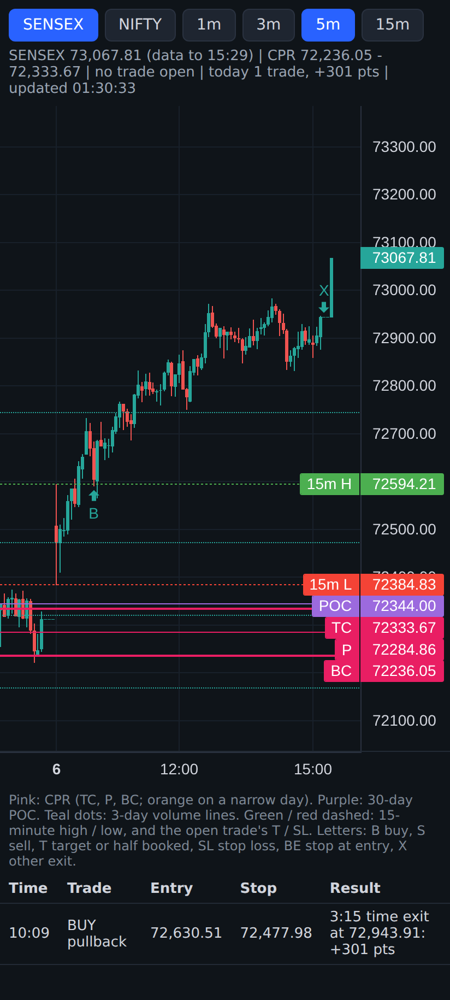

# CPR Breakout alerts: live, free, without TradingView

Free TradingView accounts now show Nifty and Sensex 15 minutes late, and the live-data add-on costs over Rs 1,000 a
month. Brokers' charts (Groww, Dhan, Zerodha) show live prices for free but can't run our own indicator.

[`cprb_alerts.py`](cprb_alerts.py) follows the same rules as the indicator (`tradingview/cpr_breakout.pine`, its
default settings) on live 1-minute candles from Upstox's free public candle data. It doesn't need an Upstox account
or a login. It tells you:

- **before 9:15:** the plan for the day: CPR, narrow or not, the volume POC (Nifty), the 3-day volume lines, yesterday's high
  and low, the CPR Magnet trigger prices;
- **9:16:** CPR Magnet BUY / SELL, or "no magnet today";
- **9:30:** the 15-minute range and the one breakout trade that is still allowed: "SELL when price touches X". Set
  a price alert in Groww at X, so you aren't late;
- **9:30-2:30:** volume-line trades (and liquidity sweeps if switched on);
- **the volume check (Sensex):** a signal whose volume doesn't agree is skipped, with a message saying so;
- **every trade:** BUY = buy the ATM call, SELL = buy the ATM put, with the stop, the target (or when to book half
  and move the stop), and the exit with points and rupees. Each entry also names **T1** (where it books half; a
  volume-line trade: its target) and **T2 / T3**, the next two price levels beyond T1, for reference only.

Alerts appear on the screen (with a beep) and, if you set it up, on your phone through Telegram (free).

**Rules** (top of the file):

- `RULES = 'classic'` (default): the original rules (daily plan + 3-day volume lines; book half, trailing, out by
  3:15); **the volume check** (`VOLCHECK`, on for Sensex): a BUY only if, over the last 2 hours (`VOL_WINDOW` = 24
  five-minute candles), the up candles carried more NIFTYBEES volume than the down candles; a SELL only if the
  down candles did. A signal it stops is reported ("skipped: the volume doesn't agree"). About the same points as
  without it from a third fewer trades, with much smaller losing runs. `SWEEP = True` adds liquidity sweeps of
  yesterday's high / low (more points, twice the trades); `LADDER = True` the volume-line ladder.
  **The largest stop** (from 17 October 2026): `STOP_MAX = {'nifty': 55, 'sensex': 170}` points with `STOP_MODE =
  'stop'`: a wider stop (the other side of the 15-minute range, 0.3% Magnet, the previous line) is moved in to it;
  book half, the targets and the trail stay where they were; the alert says "capped at 55 / 170 points". 2023-2026
  (the program's own trades): Sensex +682 / +528 / +1,206 / +8,183 a year (before +805 / −738 / +972 / +9,166), worst
  trade −182 (before −789); Nifty −135 / −505 / −224 / +1,638 (before −275 / −267 / −416 / +2,389), worst −59 (before
  −183). 95% of the calls that reached T1 came back less than 55 / 171 points first (`research/quant/mae_study.py`).
  `STOP_MAX = {'nifty': 0, 'sensex': 0}` goes back to each setup's own stop.
  **CPR BREAK calls** (`CPR_CALLS = True`; on again from 21 October 2026, the user: "add whatever makes money"): their own trades next to the others (one at a
  time; one may be open together with another call). The first 1-minute touch of today's CPR top from below -> BUY,
  of its bottom from above -> SELL (each once a day, 9:16-2:30), at the close of that candle, when one of four things
  holds: today's CPR overlaps yesterday's; the touch is between 10:00 and 11:30; price is still inside the 15-minute
  range; the day opened beyond that side of the CPR, came back and broke out again with RSI 14 (5-minute) above 55
  (BUY) / below 45 (SELL). Target `CPR_TP` 60 / 200 points, stop `CPR_SL` 35 / 100, out by 3:15; the CPR-vs-yesterday,
  gap, POC and volume rules of the other calls don't apply. The alert says which of the four held. 2023 / 2024 /
  2025 / 2026 after costs: Nifty +131 / +211 / +111 / +636 points (91 / 145 / 128 / 81 trades), Sensex +2,734 /
  +419 / +2,594 / +1,366 (103 / 156 / 127 / 90); the target came first on 34-46% (break-even 41% / 37%)
  (`research/quant/cpr_plus.py`; the program's own trades match that test). `CPR_CALLS = False` turns them off.
  **More extra calls** (from 21 October 2026, their own trades): `OHL_CALLS` OPEN HIGH LOW on Nifty (9:30: the first
  15 minutes never above the open -> SELL, never below -> BUY; target 1x the stop), `GAPFILL_CALLS` GAP FILL on Sensex
  (9:20: a 0.5-1.5% gap and a first 5 minutes back against it -> toward the fill, half way), `REENTRY_CALLS` SECOND
  CHANCE on Sensex (a call stopped, then the day turns its way -> a limit order back at the CPR edge, stop 170, held
  to 3:15). They made money in 2024-2026 (SECOND CHANCE: every year 2023-2026) and win about 4-6 in 10
  (`research/quant/classic_setups.py`, `reentry.py`, `extras_check.py`).
  **Trend / no reversal** (from 19 October 2026): at each 5-minute close from 9:35, a FALLING day (price below both
  the day's open and the CPR) or a RISING day (above both). From such moments in 2023-2026 price turned 60 / 200
  points the other way before 35 / 100 more only about 1 time in 3 before 10:30, 1 in 4 to 12:30, 1 in 5 after
  (`REV_CHANCE`; break-even 41% / 37%), and no reversal sign changed that (`research/quant/reversal_odds.py`). The
  chart shows it in a red / green bar at the top, the app on the Calls screen, and an alert says it once a day per
  direction: "FALLING DAY ... No sign of a reversal ... Don't BUY against it while price stays below X". A call
  (other than CPR BREAK) against the trend says "CAREFUL: this is against today's trend" (such calls won about 3 in
  10 and lost money).
  **Set for each index:** `VOLCHECK = {'nifty': False, 'sensex': True}` and `POC_DAYS = {'nifty': 1, 'sensex': 0}`:
  on Nifty the Magnet and the breakout buy only above yesterday's volume POC and sell only below it, with no volume
  check; on Sensex the volume check, with no POC filter (0). Tested on 2026 (`y2026_pocdays.py`): Nifty 93 trades,
  +2,389 (with the 30-day POC and the volume check +2,214); Sensex 82 trades, +9,166 (+8,001).
  `STOP_MAX = {'nifty': 30, 'sensex': 100}` holds every stop to that many points (`STOP_MODE`: 'pull' / 'stop' moves
  a wider stop in, 'skip' skips the trade). Tested on 2026 it about halved the profit (`y2026_stopcap.py`), so it
  is off (0).
- `RULES = 'rr'`, **1:4 trades**: every stop at most 0.21% of price (`STOP_PCT`), target 4x the stop
  (`RR_TARGET`), held until the target, the stop or 3:15; only the CPR Magnet and the breakout on the pullback
  (a limit order back at the broken 15-minute level).
- `RULES = 'small'`: stops of at most 150 Sensex / 45 Nifty points (`STOP_CAP`), out within 60 minutes
  (`HOLD_MIN`), target 2x the stop for the pullback, plus volume-line trades.

The chart shows a waiting limit order as a blue "LIMIT" line.

## The option chain and option charts

`/options` (with the key; also the app's Options screen): the current expiry's chain for both indices from Groww's public
data (`option_chain()`, refreshed at most every 3 seconds while someone looks), and a chart of any contract
(`option_chart()`: today's 1-minute candles from Upstox, the minutes after them from the live prices, the option's CPR
from its previous day). Data: `/api/options?i=nifty|sensex`, `/api/optchart?ex=NSE|BSE&t=<token>`.

Laid out like Groww's option chain: on a wide screen the chart on the left and the chain beside it; on a phone a short
chart above the chain. Above the chain: the PCR (put OI / call OI around the money), the call OI wall (the strike with
the most call OI: resistance) and the put OI wall (support); each strike shows its OI as a bar and its OI change, and
"OI table" switches to OI-only columns. Tap the index price for the index chart (`/api/optchart?t=index&i=`): today's
candles with the CPR, R1 / S1 / R2 / S2, yesterday's high / low, the 15-minute range, the POC and the OI walls.

OI recorder: in market hours the program writes each index's chain around the money once a minute to
`DATA_DIR/oi/<day>-<index>.jsonl` (minute, spot, PCR, walls, and per strike call OI / price, put OI / price) - free
intraday OI history doesn't exist for past days, so this builds it for later tests (about 1 MB a day).

## The phone app (Eden Trader)

The same program also serves the **Eden Trader** Android app (repository `CURIOUSMIND123/eden-trader`, which carries a
copy of this file in `engine/`): `/api/state` (today's calls), `/api/events` (the alerts, which the app turns into
notifications), `/api/history` (every call and whether the index went 50 Nifty / 150 Sensex points its way before the
stop; 2026 from `history-2026.json`, later days as they happen). Settings: `CPRB_DATA_DIR`, `CPRB_CHART_KEY_SHA256`.

## On a server instead of the phone (runs every day by itself)

A phone closes apps it isn't showing. On a server (for example Oracle Cloud) the program runs every trading day
without stopping: the plan at 8:45, every alert and the day's result in Telegram, and the live chart at a private
`https://.../?key=...` address you can add to the phone's home screen. It updates itself when this repository
changes. One command sets it up: see [`../deploy/README.md`](../deploy/README.md). (`python cprb_alerts.py --forever`
is the mode it runs in; its settings can come from environment variables, `CPRB_TELEGRAM_TOKEN` and the others.)

## The live chart (free)

While the program runs, open **http://127.0.0.1:8000** in Chrome on the same phone. It's a live candle chart drawn
from the same free Upstox prices: NIFTY / SENSEX buttons, 1 / 3 / 5 / 15-minute candles, the CPR as three pink lines
(orange on a narrow day), the POC (purple, Nifty only), the 3-day volume lines (teal dots), the 15-minute high / low, yesterday's high / low (yellow), the
open trade's stop loss and target, each named in words on the price scale, and every trade as a small letter: B buy, S sell, T target or half booked,
SL stop loss, BE stop at entry, X other exit. Each trade is drawn like TradingView's **long / short position tool**:
green from the entry to T1 (where half is booked), lighter green on to T3, red to the stop loss, with the prices and
points as labels (an open trade's box runs to the right, and the price scale always shows its T1 and stop). A legend
shows the bar's open / high / low / close and change, as on TradingView. Under the chart: today's trades with entry,
stop and result. In market hours the last candle and the price line move with the **live price every second**
(Groww's public data; the status line shows "● LIVE" and the time) until Upstox's 1-minute candle for that minute
arrives; the calls are worked out from the 1-minute candles only, as always (`LIVE_PRICE = False` switches the live
price off). **Fit** brings back the latest candles with the price scale fitted. On a weekend it shows the last session.
The chart library (TradingView's free open-source Lightweight Charts) is downloaded once and kept next to the
program. `CHART = False` at the top switches the chart off.

## Set up once

1. **Python.** On a laptop: install Python 3 from [python.org](https://www.python.org/downloads/). On Windows,
   tick "Add Python to PATH". On an Android phone: install **Pydroid 3** from the Play Store.
2. **The file.** Save `cprb_alerts.py` in a folder, for example `Documents\cprb`.
3. **Telegram (optional, for alerts on your phone):**
   1. In Telegram, open **@BotFather**, send `/newbot`, and pick a name. It replies with a token like
      `123456789:AAH...`.
   2. Open your new bot and send it any message, for example "hi".
   3. At the top of `cprb_alerts.py`, put the token between the quotes: `TELEGRAM_TOKEN = '123456789:AAH...'`.
   4. Run `python cprb_alerts.py --telegram-chat-id` (on a phone: just press Run). It prints your chat id, a
      number. Put it in `TELEGRAM_CHAT_ID = '...'`.
   5. Run `python cprb_alerts.py --telegram-test`. A test message should arrive on your phone. (On a phone, the
      "alerts started" message when you run it is the test.)
4. **Your lots.** Change `LOTS = 5` at the top if needed. It's used only for the rupee estimates (option moves are
   estimated at half the index move). `LADDER = True` switches on the volume-line ladder.

## On a Samsung phone (no computer needed)

1. From the Play Store install **Pydroid 3** and **Telegram**. That's all: the live prices come from Upstox's free
   public data, which the program fetches by itself (no Upstox app, account or login). TradingView is optional.
2. Open the copy page on the phone, tap **Copy program**. In Pydroid 3: menu, New, paste, Save as `cprb_alerts.py`.
3. Telegram alerts: do step 3 above (BotFather, then the token in the file). In Pydroid 3, open the file and press
   the yellow Run button once: it prints your chat id. Put it in `TELEGRAM_CHAT_ID`, save, and Run again: "CPR
   Breakout alerts started" arrives in Telegram.
4. Stop Android from closing it during the day (Samsung; Android closes apps you switch away from to save battery,
   and the program and the live chart stop with it):
   - Settings > Apps > Pydroid 3 > Battery > **Unrestricted**.
   - Settings > Battery > Background usage limits: turn off **Put unused apps to sleep**, and add Pydroid 3 to
     **Never sleeping apps**. Turn **Power saving** off.
   - Recent apps: tap the Pydroid 3 icon at the top of its card > **Keep open**, and don't swipe it away.
   - Keep Pydroid 3 on screen: **split screen** or a **pop-up window** with Chrome (the chart) or Groww, phone on the
     charger from 9:10 to 3:30.
   - **If it still stops**, open `cprb_log.txt` (next to `cprb_alerts.py`; everything the program printed is saved
     there). If the log ends with an error, that is the reason (after an error such as no internet the program now
     waits 60 seconds and starts again by itself). If it just ends with no error, the phone closed Pydroid 3.
   - Another way that keeps running in the background: **Termux** (from F-Droid, not the Play Store), then
     `pkg install python`, copy `cprb_alerts.py` into it, `termux-wake-lock`, `python cprb_alerts.py`.
5. Optional, the chart: open tradingview.com in Chrome (in DeX, or on the phone with "Desktop site" ticked), Pine Editor,
   paste the indicator, Save, Add to chart. After saving it once it is also in the TradingView app under
   Indicators > My scripts. Free TradingView is 15 minutes late, but the CPR, POC and volume lines come from
   earlier days, so they are right; the live signals come from the alerts.

**Samsung DeX** turns the phone into a desktop on a monitor or TV (cable or wireless) with a keyboard and mouse.
It is not needed, but it helps: Pydroid 3, TradingView and Groww open side by side in their own windows, so the
alerts program stays on screen all day.

## Every trading day

Open a terminal in the folder (on Windows: in the folder's address bar type `cmd` and press Enter). Then run:

    python cprb_alerts.py

On a phone: open the file in Pydroid 3 and press the yellow Run button.

Then open http://127.0.0.1:8000 in Chrome for the live chart.

Start it any time before 9:15 and leave it running until 3:30. On a laptop, plug it in and stop it from sleeping.
On a phone, keep Pydroid open and the screen on. If you start late, it shows what already happened as
"[earlier today]" and alerts only new things.

To see how it works without waiting for the market, replay any past day in a few seconds:

    python cprb_alerts.py --replay 2026-10-08

On a phone, put the date in `REPLAY_DAY = '2026-10-08'` at the top and press Run (empty it again for live).
`python cprb_alerts.py --plan` prints only the next session's plan. `python cprb_alerts.py nifty` runs one index.

## Checked

`research/quant/alerts_check.py` runs it on every 2026 session, minute by minute as it runs live. It took exactly the
backtest's trades: default (original rules; Nifty: yesterday's POC, no volume check; Sensex: the volume check, no
POC filter) Nifty 93 trades, net +2,389 points, Sensex 82 trades, net +9,166; with the 30-day POC on both (all the
figures that follow) and the volume check Nifty 70 trades, +2,214, Sensex 68 trades, +8,001; original rules alone Nifty 101 trades, net +2,274, Sensex 114 trades, net +8,102 (with the
ladder +2,193 / +8,819); with sweeps Nifty 203 trades, +2,993, Sensex 223 trades, +9,279; 1:4 rules Nifty 55 trades, net +1,344, Sensex 53 trades, net +4,419;
small-stop rules Nifty 150 trades, net +842, Sensex 170 trades, net +4,708. Nothing it had already said changed later in the day. The CPR uses the exchange's official daily close
(downloaded each morning), like TradingView; the official close often differs from the last 1-minute candle.

## Limits

- An alert comes when the 1-minute candle in which something happened has closed, plus a few seconds for the data.
  CPR Magnet (9:16) and volume-line trades (at a 5-minute close) are fine with that. For a breakout, use the 9:30
  message to set a price alert in Groww.
- The data is Upstox's public candle feed. It worked without a login when this was written. If Upstox changes it,
  the script will say "data error".
- It only sends alerts. You place the orders yourself in Groww.
- The rules were adjusted on 2026 itself, so live results will very likely be lower than the backtest.
- Trades held for hours (most of them) lose option value every hour (time decay), most on expiry day, so the
  rupee estimates (half the index move) are on the high side.
