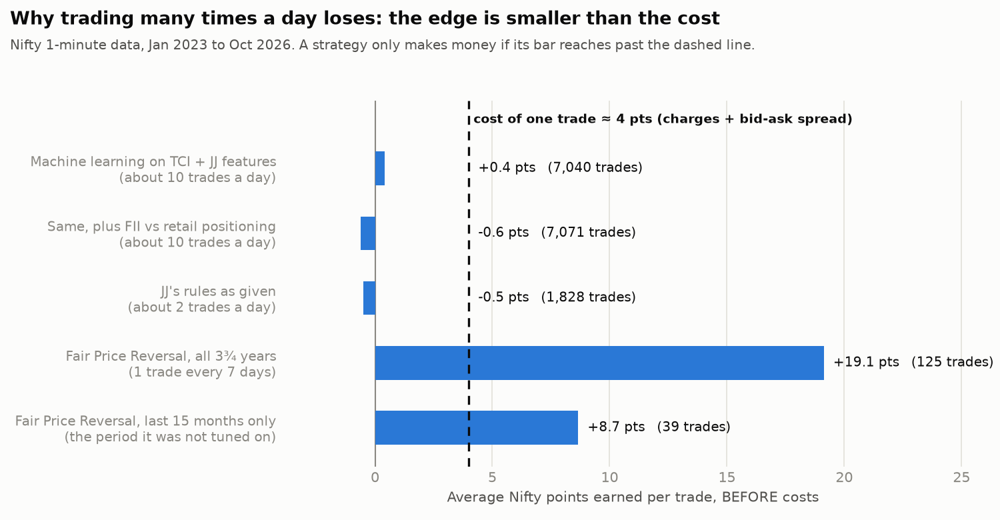
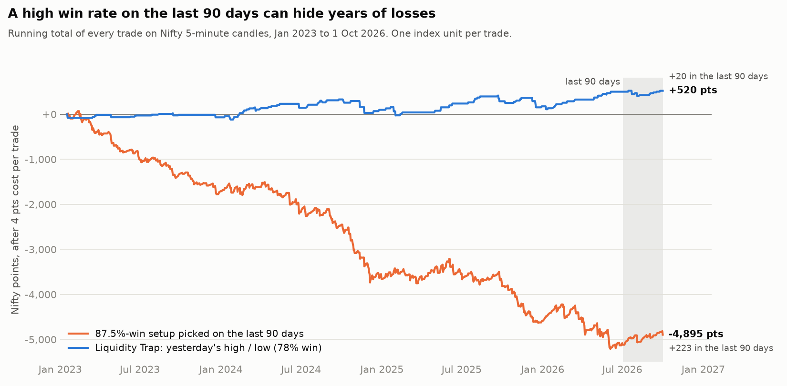
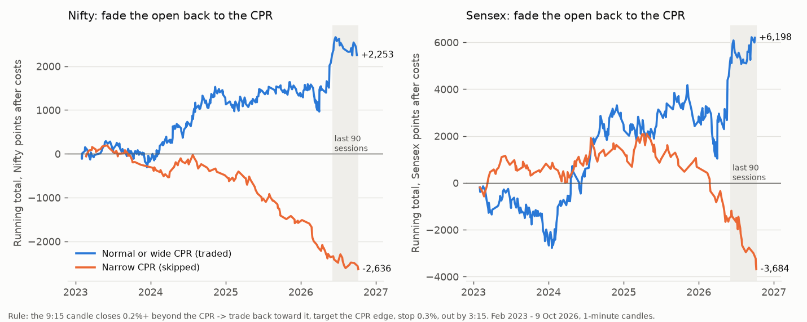
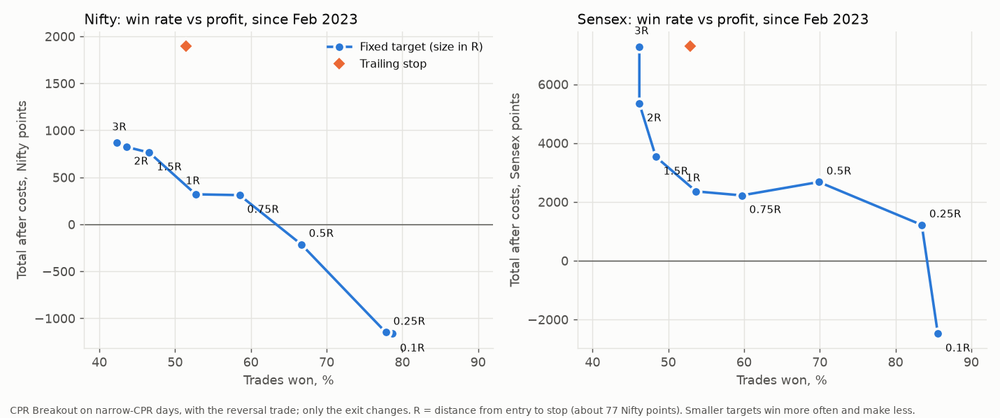

# What the tests show, in plain words

## What a backtest is

A backtest replays the past one minute at a time. At each minute the rules see only what had happened up to
then, decide whether to buy or sell, and the trade is closed at its stop, its target or 3:15, exactly as if it
were live. Every trade pays its costs. Add up all the trades and you see what the rules would have made.

The data: every 1-minute Nifty and Sensex candle from January 2023 to October 2026 (915 trading days, Upstox's
public candle API), plus NSE's daily positions of FIIs, DIIs, proprietary desks and retail clients ("participant
wise open interest") for the same days.

## The one number that decides everything: cost per trade

Buying and selling one option lot costs brokerage, STT, exchange fees, GST and the bid-ask spread. Together
that's about ₹130 per lot, which equals about **4 Nifty points** of index movement (an at-the-money option moves
about half as much as the index). A typical 30-minute Nifty move is 17 points, so every trade starts about a
quarter of a typical move behind.

To make money, a strategy's average trade has to beat 4 points before costs. The chart above shows that nothing
that trades often comes close.

## What was tested

| Approach | What it is | Result after costs |
|---|---|---|
| JJ Simon's rules as given | Opening-candle trade, then trades back to the 9:15 open | Nifty −358R over 1,828 trades, lost every year |
| 1,800 variations of JJ's rules | Stops, targets, zone distance, swing size, window, break-even, loss limits | Almost all lose. Best: Fair Price Reversal (below) |
| TCI + JJ combined | A liquidity sweep of a TCI level (yesterday's high / low, opening range) that pulls price back toward JJ's fair price; 144 variations | 40 looked good on 2023 to mid-2025, 11 stayed positive afterwards, all small. The best one in the tuning years lost −57R afterwards |
| Opening-range breakout, Supertrend, EMA crossovers | 488 variations of common indicator strategies | About break-even at best |
| Machine learning | A model reads 26 measurements every 5 minutes (TCI levels, sweeps, JJ's distance from the open, momentum, time of day, gap) and predicts the next 15 / 30 / 60 minutes. Each month it learns only from earlier months | Right 51 to 52% of the time (a coin flip is 50%). About 10 trades a day: −25,200 Nifty points over 680 days |
| Retail vs smart money | FII, retail (Client) and Pro positions in index futures and options, published by NSE every evening | Lines up slightly with the next morning's gap, which you can't trade because the data comes out after the close. Says nothing useful about 9:15 to 3:30. Added to the model, results got worse |

R means one stop-loss amount. −358R means the rules lost 358 times what one stop costs.

## Why the 19-day test looked good

Over 19 days, a strategy with no real edge can easily look profitable, the same way a coin can land heads 12
times in 19. The longer test (915 days) is what tells the truth.

## What did hold up

**Fair Price Reversal** on Nifty: trade only after price has moved far from the 9:15 open (about 94 points), on a
1-minute close back toward it, with a wide stop (about 39 points) and a 1 : 3 target (about 118 points). Its
average trade earns about 19 points before costs, so it clears the 4-point cost. It's positive in every year
from 2023 to 2026. But:

- It trades about once a week, not 10 times a day. That's why it works: it waits for the rare big move, where
  the edge is bigger than the cost.
- In the 15 months it wasn't tuned on, it earned less (about 9 points per trade before costs, +2R in total),
  and June to September 2026 lost money.

## "80% win rate" setups on the 5-minute chart

I searched 1,820 five-minute setups (TCI liquidity traps at yesterday's high / low, the opening range, swings
and the day's high / low; JJ's fair-price reversal; trend pullbacks) with small targets and wide stops, which is
how you get a high win rate.

- **523 of them won 80% or more in the last 90 days** (3 July to 1 October 2026). A high win rate is easy:
  take profit after a few points and give the stop lots of room.
- Only 16 of those 523 made money in those 90 days. Wins were small and losses big: a typical one won
  +12 points and lost −55.
- Only 1 also made money in the 90 days before that, and none did over the full 3¾ years.
- The busiest one won 87.5% of 64 trades in the last 90 days (+223 points). Over 3¾ years it won 77.5% and
  lost −4,895 points. That's the orange line above.

One setup held up on Nifty: **Liquidity Trap**, a stop hunt at yesterday's high or low. A 5-minute candle trades
about 8 points beyond the level and closes back inside; target about 25 points, stop about 59. Results:

- Nifty: 105 trades in 3¾ years (about one every 9 days), 78% won, +520 points after costs. It lost a little in
  2023 and made money in 2024, 2025 and 2026.
- Last 90 days: 10 trades, 80% won, +20 points.
- Sensex: the same rules lost −2,017 points. Treat the Nifty result as thin.

It's in `tradingview/liquidity_trap.pine` as a TradingView strategy, so TradingView's Strategy Tester shows the
same numbers on your own chart.

## Breakout, pullback, ride: trades every day

I tested 960 versions of: a breakout through a level (yesterday's high / low, the opening range, today's
swings), with or without a "real breakout" filter (a strong or expanding candle); a pullback to the level; a
reversal candle (close past the previous candle, engulfing, or pin bar); then a fixed target, a trailing stop or
holding to 3:15.

- 448 of them traded at least 0.8 times a day in the last 90 days. 43 made money there, 7 also in the 90 days
  before, 5 also over all 3¾ years, and 3 also on Sensex.
- **Win rates were 20-40%, never 70-80%.** Riding a move means many small losses (stopped or scratched at
  entry) and a few big wins. 11 versions won 70%+ in the last 90 days; none of them made money.
- The best all-round version, **Breakout Retest**: real breakout (candle range at least 1.5× the last six),
  pullback within about 12 points of the level, entry on a close past the previous candle, stop about 29
  points, stop to entry after +15, then a trail about 59 points behind the best close.
  - Nifty: 1,482 trades (1.6 a day), 25% won, average win +77 and loss −24, +1,621 points after costs.
    Last 90 days +163, the 90 days before +975, but 2025 lost −1,546. About 2 days in 3 lost money.
  - Sensex: +3,334 Sensex points over all years, but −154 in the last 90 days and −5,224 in 2025.
  - **Random buy / sell directions with the same entries and exits did as well in about 1 run in 5.** The
    profit comes mostly from cutting losers fast and riding the occasional trend, not from calling direction.

It's in `tradingview/breakout_retest.pine` as a TradingView strategy.

## 15-day levels, volume profile and consolidations

Levels rebuilt every morning from the last 15 days: every daily high and low, profile peaks (prices where the
most trading happened), and consolidations (an hour or more inside a narrow band). Lines within about 10 Nifty
points are merged into one. The Nifty index has no volume, so this test uses time spent at each price (the
classic market profile); the TradingView indicator can use Nifty futures volume instead.

I tested 1,296 versions: rejection candles at the levels (pin bar or engulfing, then trade back), or strong
breakout candles through them; which levels to use; how close counts as a touch; stop size; target at the next
level or a fixed multiple.

- 774 versions traded at least 0.8 times a day in the last 90 days. 24 made money there; none of those also made
  money in the 90 days before.
- **Rejection candles at the levels lost money**: −3,161 Nifty points and −27,882 Sensex points over 3¾ years
  using all the lines.
- **Adding profile peaks and consolidations to the trade levels made results worse** (Nifty −1,964 with them,
  +1,863 without).
- What held up: a **strong breakout candle through a "double" daily level**, where two or more of the last 15
  daily highs / lows sit within about 10 points. Stop about 12 points back across the level, target the next
  such level at least 2× the stop away.
  - Nifty: 719 trades (0.8 a day), 36% won, average win +72 and loss −36, +1,863 points after costs, positive
    in each of 2023, 2024, 2025 and 2026. Last 90 days −132, the 90 days before +138.
  - Random buy / sell directions with the same entries, stops and targets did as well in only 2% of runs.
  - Sensex: +3,304 Sensex points, but it lost in 2023 and 2026.

It's in `tradingview/levels_15d.pine`. It draws all the lines (15-day highs / lows, VOL, CONS, merged) and
trades only the tested breakouts unless you switch that off.

## All four strategies together

Fair Price Reversal, Liquidity Trap, Breakout Retest and 15-Day Levels on Nifty, one unit each, February 2023 to
1 October 2026 (901 days), after 4 points cost per trade. Their daily results are almost unrelated (correlations
between −0.10 and +0.21), so they don't all lose on the same days.

| Version | 2023 | 2024 | 2025 | 2026 | Last 90 days | All | Trades a day | Red days |
|---|---|---|---|---|---|---|---|---|
| All four | +1,963 | +2,218 | −554 | +2,354 | −13 | +5,981 | 2.7 | 56% |
| All four, skip a trade when another strategy signalled the opposite way in the last 30 minutes | +1,853 | +2,720 | +79 | +2,750 | +168 | **+7,403** | 2.5 | 56% |
| Only trades a second strategy confirmed within 30 minutes | +146 | +910 | +100 | +1,050 | +153 | +2,206 | 0.3 | 13% |

- Trades that another strategy contradicted lost on average for all four strategies (−2 to −23 points each),
  so skipping them is the one combination rule that helped everywhere. I found it after seeing these results, so
  treat it as promising, not proven.
- Even with that rule: more days lose than win (56% red), 16 of 45 months lost, the longest losing run was 10
  days, and the deepest fall was −2,461 points (June to December 2025). On one Nifty option lot (delta 0.5)
  that's about −₹80,000.

## "Breakout Probability (Expo)" on 15-minute candles

The indicator counts how often, in the chart's history, the next candle went above the current candle's high
(or below its low), split by whether the current candle is green or red, plus four more lines 0.1% further out.

- On Nifty 15-minute it shows almost the same numbers on every candle: after a green candle about 67% for a new
  high, after a red candle about 68% for a new low. In the 30 days to 7 October 2026 it never reached 70%.
  The further lines were 17% or less.
- Its strongest calls (65%+, 483 of them) were right 62% of the time by its own measure: the next candle
  touched the level, even by a fraction of a point.
- 30 minutes after the call: +7.7 points on average when it was right, −14.0 when it was wrong.
- Trading every call for 30 minutes lost −2,180 Nifty points after costs; entering only when the level broke
  lost −773. Sensex was similar (−4,731 and −906 Sensex points).
- On 3-minute candles it was the same: about 69% after a green candle and 67% after a red one, never 70%.
  Its 2,409 strongest Nifty calls were right 68% of the time, but 30 minutes later price was only +3.9 points
  ahead when right and −5.3 behind when wrong. Trading them lost −7,456 points (−4,696 entering only on the
  break); Sensex lost −22,491 and −10,201 points.

### Scalping its calls at 1 : 2

Same calls, but each one traded as a quick scalp: stop X points, target 2X, out at whichever comes first (checked
minute by minute), one trade at a time. Two entries: at the call candle's close, or only if the next candle
breaks the level. Stops of 5, 10, 15 and 20 Nifty points (Sensex scaled to its price).

- At 65% the indicator calls **every candle**: its line hardly moves, so there's always a 65%+ number on one side.
  That's about 120 calls a day on 3-minute candles and 24 on 15-minute.
- The target was hit before the stop 29-41% of the time. A coin toss hits a 2X target before an X stop about 33%
  of the time, so the calls add little. After costs you need 60% (stop 5), 47% (stop 10), 42% (stop 15) or
  40% (stop 20).
- Nifty 3-minute, last 30 days: every version lost, from −6,349 points (enter at close, stop 5) to −338 points
  (enter on the break, stop 20 / target 40, 8 of 21 days green). The 12 months before: all lost, from −83,100 to
  −11,828.
- Sensex 3-minute, last 30 days: all lost (best −69 Sensex points, enter on the break, stop 20); the 12 months
  before lost −35,438 to −260,529.
- 15-minute candles: Nifty lost in every version (best −379 in 30 days; −6,767 or worse in the 12 months before).
  The only profit in the whole test was Sensex 15-minute, enter on the break, stop 20 / target 40: +550 Sensex
  points in the last 30 days, but −19,039 over the 12 months before.

### Did it ever show 90%?

Every 3- and 5-minute candle from early 2023 to 7 October 2026, with the numbers worked out from the last 5,000
candles, as a live chart would show them.

- **It never showed 90%, or even 75%.** Highest ever: Nifty 72.5% (3-minute) and 73.6% (5-minute), Sensex 71.1%
  and 73.3%. It counts thousands of candles, so one new candle barely moves the number.
- Its highest 1% of readings (about 71-74%) lost on every test: Nifty −2,122 (3-minute) and −1,786 (5-minute)
  points scalping at 1 : 2, worse when held 30 minutes. Sensex lost too.
- With a short memory (only the last 50 candles), it does show 90%+, about once every 2-3 days. Those calls were
  mixed: Nifty 5-minute held 30 minutes made +1,203 points over 471 trades (about +2.6 a trade after costs), but
  Nifty 3-minute lost −847 with the same rule and Sensex 5-minute lost −4,124. 4 of 12 combinations made money,
  about what luck gives.

## CPR and pivots

CPR (central pivot range) from the previous day's high, low and close: pivot P = (H + L + C) / 3, BC = (H + L) / 2,
TC = 2P − BC. "Narrow" means today's CPR is among the narrowest third of the last 20 days.

**What repeated (last 60 sessions, 16 July to 9 October 2026, and every day since 2023):**

- **A narrow CPR did not bring bigger days.** Nifty's narrow-CPR days moved 0.69% high to low on average in the
  last 60 sessions; wide-CPR days moved 0.82%. Since 2023: 0.87% vs 0.98%, and a 1%+ day happened 30% of the time
  on narrow days and 34% on wide ones. Sensex was the same. The CPR's width is just two-thirds of the distance between
  yesterday's close and the middle of yesterday's range (close near the middle = narrow), so it doesn't measure
  a squeeze.
- **When the day opens above the CPR, price comes back to it about two times in three** (Nifty 63%, Sensex 66%
  since 2023), and the same when it opens below. Days that opened above it closed lower slightly more often than
  not (53-56%).
- In the last 60 sessions, Sensex days that opened above a CPR that wasn't narrow closed lower 12 times in 16.
  Since 2023 that happened only about half the time (54%).

**What I tested:** 576 rule versions in five families: fade the open back to the CPR; opening-range breakout,
with or without the narrow-CPR filter; a 5-minute close through the CPR; a poke through R1 / S1 that closes back;
and holding all day for or against the CPR. Entries and exits on 1-minute candles, after costs.

- **The best versions in the last 60 sessions were luck.** On Nifty they were opening-range breakouts (best
  +585 points); on Sensex, holding all day in the open's direction on narrow-CPR days (best +2,238 Sensex
  points). All 15 best on each index lost in the 30 sessions before. Since 2023, 12 of the Nifty 15 and 10 of the
  Sensex 15 lost, and each of the rest had at least one losing year.
- **Picked on February 2023 to June 2025 only**, the top 3 versions (hold all day against the CPR on narrow
  days) lost afterwards on both indices. The next 7 included 5 "fade back to the CPR on normal or wide days"
  versions, and all 5 made money afterwards on both.

**What held up: CPR Magnet.** Skip narrow-CPR days. If the 9:15 one-minute candle opens above the CPR and closes
at least 0.2% above it, sell at that close (9:16); if it opens below and closes 0.2% below, buy. Target the near
edge of the CPR, stop 0.3% of price (about 68 Nifty points), out by 3:15.

| | Trades | Won | Total after costs | Per trade | Last 90 sessions | Deepest fall |
|---|---|---|---|---|---|---|
| Nifty | 313 (1.7 a week) | 50% | +2,253 pts | +7.2 | 26 trades, +5 | −673 |
| Sensex | 294 | 49% | +6,198 pts | +21.1 | 25 trades, +1,055 | −3,139 |
| Nifty, same rule on narrow days | 142 | 37% | −2,636 | −18.6 | | |

- Same entries, stop and target distance, but a coin toss for the direction: as good in only 2 of 300 runs, on
  both indices.
- Weak spots: both lost in 2023 (Nifty −180, Sensex −2,444). Nifty lost −282 in the last 60 sessions, when the
  market kept falling and the buys back toward the CPR were stopped out. About half the profit came from two
  months (May and June 2026 on Nifty). Not every nearby setting works: about half of the "fade on normal days"
  versions made money on Nifty since 2023.

It's in `tradingview/cpr_magnet.pine`.

## Open vs the CPR, the 15-minute break, and the 15-day profile

Your ideas, checked on the last 90 sessions (3 June to 9 October 2026) and on every day since 2023:

| Idea | Last 90 sessions | Since 2023 |
|---|---|---|
| Opens above the CPR, so the day goes up: closed higher than the open | Nifty 47%, Sensex 37% | Nifty 47%, Sensex 44% |
| Opens below the CPR, so the day goes down: closed lower than the open | Nifty 49%, Sensex 52% | Nifty 50%, Sensex 49% |
| Opens above the CPR: still above the CPR at the close | Nifty 69%, Sensex 60% | Nifty 70%, Sensex 66% |
| First 5-minute close beyond the 15-minute high / low: still that way at the close | Nifty 48%, Sensex 54% | Nifty 51%, Sensex 51% |
| Same break: reached 1R before the stop at the other side of the range | Nifty 33%, Sensex 28% | Nifty 36%, Sensex 34% |
| Same break: reached 3R (a 1:3 target) before the stop | Nifty 2%, Sensex 0% | Nifty 5%, Sensex 4% |

So neither idea is right much more than half the time on its own. The CPR does tend to hold as a floor or
ceiling by the close (about two days in three).

I tested 3,888 combinations: open-vs-CPR direction, the 15-day point of control (POC, the price traded most in 15
days; time at price, since the index has no volume) and its value area, the 5-minute EMA 50, today's CPR vs
yesterday's, CPR width, entry on a 5-minute close or a touch, three stops, a 1:3 target / ride / trail, and an
optional reversal trade after a failed break.

- **None won 80% of its trades** in the last 90 sessions (10+ trades). Best: Sensex 77% of 13 trades; Nifty 63% of 30.
- 216 made money in the last 90 sessions and since 2023 on both indices; none made money every year on both.
- Picked on February 2023 to June 2025 only, 2 of the top 50 made money afterwards. 50 of those 50 used the
  open-vs-CPR filter, which stopped working after mid-2025.
- What held up best: **breakouts on narrow-CPR days.** Trade only when today's CPR is among the narrowest third of
  the last 20 days. Don't sell when today's CPR is wholly above yesterday's, or buy when it's wholly below. Enter
  on a touch of the 15-minute high or low, with the stop at the other side of the range. After +1R, trail the stop
  1R behind the best price. If the first trade loses, take the break of the other side once.

| | Last 90 sessions | Since 2023 | By year 2023 / 2024 / 2025 / 2026 |
|---|---|---|---|
| Nifty | 34 trades, 20 won / 14 lost, +1,068 / −807, **net +262** | 276 trades, 51% won, +1,896 | −181 / +1,277 / −118 / +918 |
| Sensex | 31 trades, 22 won / 9 lost, +3,985 / −1,986, **net +1,998** | 272 trades, 53% won, +7,296 | −50 / +4,340 / −1,394 / +4,401 |
| Nifty, same rules on days that are not narrow | 51 trades, −518 | 593 trades, −2,300 | |

- With the reversal trade, narrow days beat other days on both indices in both halves of the data (before and
  after July 2025), for every exit style. Without the reversal trade they were not better before July 2025. It's
  your friend's narrow-CPR idea in breakout form, and the one pattern here that looks real.
- Average win about +53 and loss −58 Nifty points: 1:3 targets were rarely reached, so the fixed 1:3 version made
  less (Nifty last 90 +86, since 2023 +866).
- The open-vs-CPR filter cut trades and profit (Nifty since 2023 +1,570, Sensex +2,306). The POC filter lowered
  it too (+1,433 and +3,828); the value-area filter turned Sensex into a loss (−1,023).
- I chose these settings after seeing all the results, so treat them as promising, not proven.

It's in `tradingview/cpr_breakout.pine`.

## Can it win 90%?

Yes, if the target is small enough, but then it stops making money. The CPR Breakout above, with only the exit
changed (since February 2023, narrow-CPR days, with the reversal trade):

| Exit | Nifty: won / total | Sensex: won / total |
|---|---|---|
| Target 0.1R (about 8 Nifty points) | 79%, −1,164 | 86%, −2,484 |
| Target 0.25R | 78%, −1,149 | 83%, +1,216 |
| Target 0.5R | 67%, −213 | 70%, +2,676 |
| Target 1R | 53%, +320 | 54%, +2,357 |
| Target 3R | 42%, +866 | 46%, +7,272 |
| Trail | 51%, +1,896 | 53%, +7,296 |

In the last 90 sessions alone the 0.1R target won 97% (Nifty) and 100% (Sensex). Over 3¾ years it won 79-86%
and lost money: the few losses (a full stop, about −80 points) wiped out many +4-point wins.

I also tried 3,072 versions with trend filters (20-day and 5-day trend, yesterday's candle, the opening gap, the
first 15-minute candle, price beyond the CPR at entry, EMA 50) and with booking half early:

- 248 Nifty and 369 Sensex versions won 90%+ in the last 90 sessions. Only 26 and 104 of those also made money
  since 2023, and none on Nifty (4 on Sensex) kept a 90% win rate since 2023.
- Highest win rate that made money on both indices in both periods: **narrow-CPR days, only in the direction of
  the opening gap, book half at 0.25R, move the stop to entry, trail the rest.**
  - Last 90 sessions: Nifty 19 trades, 17 won / 2 lost, +232 / −135, net +97. Sensex 16 trades, 16 won / 0 lost,
    net +577.
  - Since 2023: Nifty 137 trades, 76% won, +549; Sensex 132 trades, 82% won, +1,654. Both lost in 2023 and 2025.
  - It trades about once a week (only 1 trade in the last 30 sessions), and it earns about +4 Nifty points a
    trade after costs over 3¾ years, so a little slippage would erase it.

`research/quant/cpr_orb_winrate.py`, `cpr_winrate_pick.py` and `cpr_scalp_lastn.py` reproduce this.

## Pure scalping at the CPR, pivots and the 15-minute range

Every time price crossed a level on a 1-minute candle (15-minute high / low, CPR top / bottom, R1 / S1 / R2 / S2),
a scalp: with the break or back against it, targets of 10-30 Nifty points, stops of 10-40, out after 10 or 30
minutes or at 3:15, narrow days or every day, with or without the open-vs-CPR, CPR-vs-yesterday or first-candle
filter. Up to 5 trades a day; 3,072 versions per index.

- Nifty: 1 version won 90%+ in the last 90 sessions (20+ trades), and it lost money since 2023. 42 won 80%+;
  none of those made money both in the last 90 sessions and since 2023.
- Sensex: none won 90%; 26 won 80%+, and none of those made money in both periods either.
- Only 3 versions made money on both indices in the last 90 sessions and since 2023, and they earned about +0.2
  to +0.3 points a trade over 3¾ years, which is break-even.
- The reason is cost: about 4 Nifty points a trade is 13-40% of a 10-30 point target. With a 20-point target and
  a 20-point stop you need 60% wins just to break even, not 50%; with a 10-point target and a 30-point stop, 85%.

`research/quant/cpr_scalp.py` and `cpr_scalp_pick.py` reproduce this.

## Price action and candle types, read by a model (2026 only)

Instead of testing one idea at a time, a model looked at every 5-minute candle and about 55 measurements:
- candle shape (body, wicks, where it closed, size, engulfing, pin bar, inside / outside bar, doji, runs of
  same-colour candles);
- momentum and EMA 20 / 50;
- distance to every level (CPR, pivot, R1-R2 / S1-S2, the 15-minute high / low, yesterday's high / low / close,
  the 15-day POC and value area);
- CPR width and direction, time of day, the day's range, and volatility.

It learned which of them came before **+25 before −15** (or the same sized to volatility: +1.67 ATR before
−1 ATR). It was retrained every month on earlier months only, then scored January to 9 October 2026, which it
hadn't seen. It traded only its top-scoring 1%, 3% or 10% of moments, one trade at a time.

From a random moment, +25 comes before −15 only 34% of the time. After costs, 25 / 15 needs 47.5% to break even.

| 2026, top 1% of scores | Trades | +25 first | Won / lost | Points after costs | Last 90 sessions |
|---|---|---|---|---|---|
| Nifty, 25 / 15 | 105 | 42% | 44 / 61 | −196 | −62 |
| Nifty, 25 / 15, then let it run | 105 | 42% | 44 / 61 | −159 | −74 |
| Nifty, sized to volatility | 117 | 44% (random 31%) | 54 / 63 | **+273** | −76 |
| Sensex, 25 / 15 | 154 | 35% | 56 / 98 | −2,089 | −792 |
| Sensex, sized to volatility | 112 | 35% | 42 / 70 | −1,441 | −1,051 |

Taking more trades (top 3% or 10%) lost more on both indices.

- On Nifty the model did find better moments: +25 came first 42-44% of the time, against 31-34% at random. That's
  real skill, but it's short of the 47.5% needed after costs. The one profitable version made its money in
  January to April and lost in the last 90 sessions.
- On Sensex it found almost nothing.
- **What it relied on:** mostly volatility (how fast the market was moving), which says how likely either side is
  to be hit, not which side. Candle shapes added almost nothing (scrambling them barely changed its accuracy:
  0.003 on Nifty, 0.0004 on Sensex, on a scale where 0.5 is a coin toss).

## 2026 only: why trades lost, volume zones and Fibonacci

From here on, everything is 1 January to 9 October 2026 (191 sessions). Real volume comes from NIFTYBEES, the Nifty
ETF, spread over the index's price range minute by minute (the index itself has no volume).

| 2026, after costs | Nifty | Sensex |
|---|---|---|
| CPR Magnet | 72 trades, 34 won / 38 lost, net +941 | 72 trades, 34 won / 38 lost, net +3,560 |
| CPR Breakout, trail | 57 trades, 32 won / 25 lost, net +918 | 45 trades, 31 won / 14 lost, net +4,401 |
| CPR Breakout, scalp mode | 33 trades, 29 won / 4 lost, net +603 | 26 trades, 24 won / 2 lost, net +1,087 |

**What the losers had in common.** I compared winners and losers on 14 properties: direction, time, gap, yesterday's
candle, 5-day trend, the 30-day Fibonacci trend, position vs the 30-day volume POC and value area, high-volume
nodes or Fibonacci levels between entry and target, being near a volume node or a Fibonacci level, and volatility.
An adjustment counted only if it improved results in January-June and July-October on both indices.

- **Only on the volume side of the 30-day POC** (buys above it, sells below) and **only before 10:00** passed for
  both breakout versions.
- Nothing passed for CPR Magnet on both indices. Its Nifty trades within half an ATR of a 30-day Fibonacci level
  won 9 of 11 (+520); on Sensex the same kind of trade won only 3 of 6.
- Trading **at** the volume zones or Fibonacci levels (432 scalp versions: break or bounce, 15-30 point targets,
  10-20 point stops) made money in both halves of 2026 on neither index.

The adjusted breakout, simulated exactly as the indicator trades it:

| 2026 | Nifty | Sensex |
|---|---|---|
| Scalp mode + POC side + before 10:00 | 20 trades, **19 won / 1 lost**, +886 / −66, **net +820** | 16 trades, **16 won / 0 lost**, **net +1,254** |
| Trail + POC side + before 10:00 | 30 trades, 20 won / 10 lost, net +1,550 | 27 trades, 21 won / 6 lost, net +4,700 |

These adjustments were chosen by looking at 2026 itself, so part of the improvement may be luck; the half-year
check lowers that risk but doesn't remove it. The rule trades about once every 10 sessions.

## 2026: a trade most days

The adjusted CPR Breakout traded only about once every 10 sessions because it waited for narrow-CPR days. Two
changes give a trade on about half of all days:

1. The same breakout filters (gap direction, POC side, before 10:00) also worked on days that are **not** narrow:
   Nifty 21 trades, 19 won / 2 lost, +264; Sensex 22 trades, 21 won / 1 lost, +1,450 (positive in both halves).
2. On days that aren't narrow, CPR Magnet trades at 9:16 when the open is 0.2%+ beyond the CPR.

| 2026, one plan per day | Nifty | Sensex |
|---|---|---|
| Daily plan, magnet books half (indicator default) | 99 trades, **81 won / 18 lost**, +2,197 / −1,280, **net +917** | 98 trades, **85 won / 13 lost**, +5,682 / −3,141, **net +2,542** |
| Jan-Jun / Jul-Oct | +916 / +1 | +1,026 / +1,516 |
| Daily plan, magnet full target | 99 trades, 59 won / 40 lost, net +1,834 | 98 trades, 60 won / 38 lost, net +5,514 |

About 10 trades a month on each index; no trade on days when the open is near a wide CPR and no breakout passes
the filters (often sideways days). On Nifty the magnet with half booking made almost nothing in 2026 (+23 from 72
trades); the profit came from the breakout. Booking half needs at least 2 lots.

## 2026: cutting the daily plan's losing trades

Every Sensex loss and 16 of the 18 Nifty losses in the daily plan were CPR Magnet trades that hit the full 0.3%
stop, most within 15 minutes of the open. I tested changes to the magnet part only, on the whole plan:

| 2026, whole daily plan | Nifty | Sensex |
|---|---|---|
| As it was | 99 trades, 81 won / 18 lost, +2,197 / −1,280, net +917 | 98 trades, 85 won / 13 lost, +5,682 / −3,141, net +2,542 |
| **Magnet only on the 30-day POC side** (indicator default) | 63 trades, **56 won / 7 lost**, +1,678 / **−486**, **net +1,192** | 66 trades, **62 won / 4 lost**, +4,558 / **−960**, **net +3,597** |
| Also skip magnet when the open is outside yesterday's range | 48 trades, 44 won / 4 lost, +1,438 / −256, net +1,181 | 43 trades, 42 won / 1 lost, +3,377 / −234, net +3,143 |
| Magnet stop 0.2% instead of 0.3% | 82 won / 17 lost, net +1,014 | 84 won / 14 lost, net +2,481 |
| Exit magnet if half isn't booked in 20 minutes | 79 won / 20 lost, net +1,058 | 83 won / 15 lost, net +2,790 |

- A tighter stop or a time stop cut each loss a little but turned some winners into losers.
- Filtering out the bad magnet days worked better. The 30-day POC side is the same rule the breakout already
  uses, so the whole plan now follows one volume rule. On days the magnet skips, the plan falls back to the
  breakout, which often doesn't trigger, so there are fewer trades (about 7 a month instead of 10).
- Every part of each version was positive in January-June and July-October, but these were picked on 2026 itself.

## 2026 in rupees: Rs 30,000 in options

Rough conversion: an at-the-money option moves about half as much as the index, so with lots of 65 (Nifty) and
20 (Sensex), one index point is worth about Rs 32.5 (Nifty) or Rs 10 (Sensex) per lot. Two lots per trade (the plan
books half), costs included, no compounding. Time decay and the extra brokerage of booking half are left out.

| 2026 (1 Jan - 9 Oct), Rs 30,000 start | Trades | Won / lost | End value | Biggest fall from a high | Biggest single loss |
|---|---|---|---|---|---|
| Nifty, indicator default | 63 (6.8 a month) | 56 / 7 | Rs 1,07,468 | Rs 9,552 | Rs 5,288 |
| Sensex, indicator default | 66 (7.1 a month) | 62 / 4 | Rs 1,01,945 | Rs 4,891 | Rs 4,891 |
| **Both indices, indicator default** | 129 on 76 days (13.9 a month) | 118 / 11 | **Rs 1,79,413** | Rs 13,857 | Rs 5,288 |
| Both indices, earlier plan (more trades) | 197 on 111 days (21.2 a month) | 166 / 31 | Rs 1,40,408 | Rs 39,145 | Rs 5,288 |

- Trading Nifty and Sensex together gives a trade on about 2 days in 5. The earlier plan traded more often (about
  3 days in 5) but made less and fell much further: its worst fall, Rs 39,145, is more than the whole starting
  capital.
- One full loss on 2 lots is about Rs 5,000, about a sixth of Rs 30,000. Two in a row at the start would take a
  third of the account.
- These settings were chosen on 2026 itself, so live trading will very likely do worse than this.

## 2026: the daily plan on Bitcoin

Binance BTCUSDT futures, every 1-minute candle from January to 9 October 2026 (Binance's public archive). Bitcoin
trades around the clock, so each UTC day (5:30 am IST) is a "session": CPR from the previous UTC day, opening
range 00:00-00:15 UTC, a 30-day volume POC from Bitcoin's own volume, no gap filter (there's no overnight gap).
Costs: 0.05% taker fee each side plus 0.01% slippage, 0.11% of the position per trade.

| 2026 | Trades | Won / lost | Total, % of price |
|---|---|---|---|
| Nifty settings (entries within 45 min, magnet 0.2% / 0.3%, out after 6 hours) | 169 (18 a month) | 24 / 145 | −24.7% |
| Magnet sized 3x for Bitcoin's volatility | 148 | 30 / 118 | −21.5% |
| Entries within 2 hours, magnet 3x | 188 | 36 / 152 | −26.0% |
| Nifty settings with no fees at all | 165 | 131 / 34 | −5.9% |

Every version lost money in both halves of 2026. The scalp's typical gain (about 0.05-0.1% of price) is smaller
than Binance's fees, and even with no fees it lost.

Rs 30,000 traded with the Nifty settings, whole balance as margin:

| Leverage | 1x | 2x | 5x | 10x | 20x | 50x | 100x | 125x | 150x |
|---|---|---|---|---|---|---|---|---|---|
| End of 2026 | Rs 23,396 | Rs 18,174 | Rs 8,289 | Rs 1,964 | wiped out 6 Feb | wiped out 6 Feb | wiped out 19 Jan | wiped out 19 Jan | wiped out 2 Jan |

At 150x a move of about 0.27% against the position (1/150 minus Binance's 0.4% maintenance margin) liquidates it;
Bitcoin moves that much in a few minutes on most days.

## 2026: every strategy on Bitcoin

Each strategy's own code, fed Bitcoin's 1-minute candles during Indian market hours (9:15 am - 3:30 pm IST, every
day) so it has the open, overnight gap and previous day it was built for. Costs 0.11% of price a trade (Binance
taker fee both sides plus slippage, about $79 at the 2026 median price). Rs 30,000 with the whole balance as
margin, compounding.

| Strategy, 2026 | Trades | Won / lost | Total after costs | Before costs | Rs 30,000 at 1x | 10x | 20x | 150x |
|---|---|---|---|---|---|---|---|---|
| Fair Price Reversal | 31 | 7 / 24 | −4.4% | −1.0% | Rs 28,700 | Rs 18,907 | Rs 11,432 | wiped out |
| Liquidity Trap | 39 | 19 / 20 | −3.8% | +0.5% | Rs 28,877 | Rs 20,281 | Rs 13,396 | wiped out |
| Breakout Retest | 598 | 108 / 490 | −57.3% | +8.5% | Rs 16,876 | wiped out | wiped out | wiped out |
| 15-Day Levels | 102 | 20 / 82 | −13.3% | −2.1% | Rs 26,247 | Rs 7,354 | Rs 1,559 | wiped out |
| Breakout Probability scalp | 7,002 | 2,468 / 4,534 | −703% | +66.7% | wiped out | wiped out | wiped out | wiped out |
| CPR Magnet | 155 | 44 / 111 | −17.9% | −0.8% | Rs 25,035 | Rs 4,017 | Rs 359 | wiped out |
| CPR Breakout, trail | 141 | 38 / 103 | −14.7% | +0.8% | Rs 25,879 | Rs 6,621 | Rs 1,355 | wiped out |
| CPR Breakout, scalp mode | 73 | 8 / 65 | −7.3% | +0.8% | Rs 27,899 | Rs 14,394 | Rs 6,777 | wiped out |
| CPR level scalp | 217 | 133 / 84 | −16.9% | +7.0% | Rs 25,329 | Rs 5,397 | Rs 922 | wiped out |
| Daily plan (indicator default) | 126 | 9 / 117 | −14.6% | −0.8% | Rs 25,911 | Rs 6,802 | Rs 1,477 | wiped out |

Every strategy lost money in both halves of 2026. The few that were positive before costs earned 0.01-0.03% of
price a trade, well under the 0.11% a trade costs (and under the 0.04% even with maker fees on both sides).
Leverage multiplied the losses; at 50x and above every one was wiped out, and at 150x most were gone in January or
February. Liquidations are counted only from closing losses, so real ones would come sooner.

## A strategy built for Bitcoin, tested on 2026

Hourly BTCUSDT futures candles and Binance's actual funding payments, January 2023 to 9 October 2026. Costs 0.11%
of the position a trade plus funding every 8 hours. Four families that hold for hours to days, so a typical move is
several times the fees: Donchian breakouts, EMA trend, daily volatility breakouts, and buying dips in an uptrend;
60 versions in all, each long-and-short or long-only.

The test was set up before looking at 2026: keep versions that made money in each of 2023, 2024 and 2025, pick the
best from each family by profit against worst fall, then see what 2026 does.

| Picked on 2023-2025 | 2023-2025 | 2026 (unseen) |
|---|---|---|
| Donchian, 4-hour, 55 candles, 3 ATR trailing stop, long only | 49 trades, +105% | 16 trades, 4 won, **−9.4%** |
| EMA 50 / 200, 4-hour, long only | 15 trades, +134% | 5 trades, 1 won, **−12.3%** |
| Dip buying, RSI(2) under 5, out after 24 hours, long only | 234 trades, +27% | 49 trades, 17 won, **−8.6%** |
| Daily volatility breakout | no version made money in all three years | - |

All three picks lost in 2026; Bitcoin itself fell 5.7% over the same time.

What did hold up was the 4-hour trend-following family as a whole: all 20 of its versions made money over
2023-2025, and 13 of 20 made money in 2026 (average +9.0% per version at 1x). Traded together with Rs 30,000 split
equally:

| Leverage | 1x | 2x | 3x | 5x | 10x | 20x | 150x |
|---|---|---|---|---|---|---|---|
| 2026 | Rs 31,969 | Rs 32,533 | Rs 31,861 | Rs 27,832 | Rs 12,854 | Rs 144 | Rs 0 |
| 2023-2025 | Rs 59,049 | Rs 89,352 | Rs 1,15,159 | Rs 1,40,174 | Rs 27,777 | Rs 0 | Rs 0 |

- A small profit in a year Bitcoin fell, at 1x-3x. From 5x up, the swings inside each trade cost more than the
  extra size made, and from 20x most versions were liquidated.
- The best single version in 2026 (EMA 20 / 50, 4-hour, long and short, +47.8%) would not have been picked in
  advance: it lost money in one of the design years.
- Looking at the basket was my choice after seeing 2026, so treat even the +7% as a hint, not a proven result.

## Volume lines: break one, ride to the next (3, 7 or 15 days)

Every morning: the volume profile of the last 3, 7 or 15 days, and its lines (the point of control plus every
high-volume peak, lines within 0.15% merged). A close through a line starts a trade that way; the target is the next
line; the stop is 0.5 or 1 ATR behind the broken line, or the previous line; trades whose target is less than 1 /
1.5 / 2 times the stop away are skipped.

**Bitcoin** (hourly candles, real volume, fees and funding; designed on 2023-2025, tested on 2026): 53 of 54
versions lost in 2026, average −19%. The one version picked on 2023-2025 (7-day lines, previous-line stop, buys only)
lost −15.7% in 2026.

**Nifty and Sensex, 2026** (NIFTYBEES volume, 5-minute closes, 9:30-2:30, out by 3:15): 7- and 15-day lines mostly
lost, especially on Sensex. **3-day lines with the stop at the previous line** made money in both halves of the year
on both indices:

| 2026, 3-day lines, stop at the previous line | Trades | Won / lost | Points won / lost | Net | Worst fall |
|---|---|---|---|---|---|
| Nifty, target at least 1.5x the stop | 38 (4.1 a month) | 24 / 14 | +2,119 / −792 | **+1,327** | −205 |
| Sensex, target at least 1.5x the stop | 53 (5.7 a month) | 27 / 26 | +10,039 / −5,292 | **+4,747** | −1,334 |
| Nifty, target at least 1x | 71 | 39 / 32 | +3,080 / −1,970 | +1,110 | −313 |
| Sensex, target at least 1x | 88 | 41 / 47 | +12,775 / −9,679 | +3,096 | −1,782 |

The neighbouring settings agree (1x, 1.5x and 2x targets all positive on Nifty), but this was found by looking at
2026's 27 versions per index, so part of it may be luck.

## 2026: the daily plan plus 3-day volume lines

The CPR daily plan (indicator default) and the 3-day volume-line breakouts (stop at the previous line, target the
next, target at least 1.5x the stop) in one book: one trade at a time, whichever signal comes first.

| 2026 | Trades | Won / lost | Points won / lost | Net | Jan-Jun / Jul-Oct |
|---|---|---|---|---|---|
| Nifty, daily plan alone | 63 (6.8 a month) | 56 / 7 | +1,678 / −486 | +1,192 | +716 / +476 |
| **Nifty, plan + volume lines** | 99 (10.6 a month) | 79 / 20 | +3,688 / −1,234 | **+2,454** | +1,925 / +529 |
| Sensex, daily plan alone | 66 (7.1 a month) | 62 / 4 | +4,558 / −960 | +3,597 | +2,234 / +1,364 |
| **Sensex, plan + volume lines** | 116 (12.5 a month) | 87 / 29 | +13,810 / −5,916 | **+7,894** | +6,349 / +1,545 |

Running both side by side instead (both can be open at once) gave about the same (Nifty +2,519, Sensex +8,344).
Taking volume-line trades with targets only 1x the stop gave more trades (14-16 a month) but less profit.

In rupees, 2 lots a trade on both indices (delta 0.5, lots 65 / 20): Rs 30,000 -> about Rs 3,47,000, every month
positive, lowest Rs 27,144, biggest fall from a high Rs 32,328. The same trades in random order fell below Rs 15,000
4.7% of the time and below zero 0.3%. The volume-line part was chosen on 2026 itself, like the other adjustments.

## 2026: every trade of the indicator, and better exits?

Both directions are traded: BUY = call, SELL = put.

| 2026 | Calls (buys) | Puts (sells) | CPR Magnet | CPR Breakout | 3-day volume lines |
|---|---|---|---|---|---|
| Nifty | 34 trades, 27 won, +860 | 65 trades, 52 won, +1,593 | 23, 19 won, +147 | 40, 37 won, +1,045 | 36, 23 won, +1,262 |
| Sensex (points / 3.2) | 51 trades, 36 won, +2,797 | 65 trades, 51 won, +5,097 | 29, 25 won, +690 | 37, 37 won, +2,907 | 50, 25 won, +4,297 |

- **Magnet and Breakout winners** usually kept going after we booked: after a magnet exit price went on another ~90
  points our way (median), after a breakout exit ~40.
- **Volume-line winners** booked at the next line rarely had more to give; many closed at 3:15 below their best.
- **Magnet and Breakout losers** went wrong at once (most stopped within 15 minutes, almost never in profit first).
- **Volume-line losers** were mostly in profit first: about 3 in 4 were up 20+ points before being stopped.

Changes tested on the whole indicator (one at a time, then all 64 combinations):

| 2026, net points | Nifty | Sensex |
|---|---|---|
| As now | +2,454 (20 losses) | +7,894 (29 losses) |
| Volume lines: stop to entry once halfway to the target | +1,620 | +4,761 |
| Volume lines: at the target book half, ride the rest to the following line | +2,373 | +8,612 |
| Magnet: rest to the far edge of the CPR | +2,524 | +7,656 |
| Magnet: trail the rest 1R behind the best price | +2,435 | +7,940 |
| Breakout: trail 2R instead of 1R | +2,507 | +7,706 |
| Breakout: hold the rest to 3:15 | +2,537 | +7,696 |

- Moving the volume-line stop to entry cut the losses but cut the wins more: many winners first dipped back to the
  entry before reaching the next line.
- Letting winners run gained on some trades and gave back on others; each change helped one index and hurt the
  other. None of the 64 combinations was better in both halves of 2026 on both indices; the best gained 2-7%.
- So the exits stay as they are. The remaining losses are mostly trades that are wrong from the first minutes,
  which only a better entry filter (like the POC rule) can remove.
- The ladder is in the indicator as an option, off by default ("Ladder" under the volume-line settings): at the
  next line book half, move the stop to the broken line, ride the rest to the line after. Sensex 114 trades, 87 won /
  27 lost, +13,916 / −5,305, net +8,612 (Jan-Jun +7,144, Jul-Oct +1,467); Nifty 98 trades, 78 won / 20 lost, net
  +2,373 (Jan-Jun +1,843, Jul-Oct +529). All of its gain came in January-June.

## 2026: is this the best of everything tested?

Every Nifty / Sensex strategy with a 2026 result, net points after costs (1 January to 9 October, 191 sessions):

| 2026, net points | Nifty | Sensex |
|---|---|---|
| Price-action model, best version | +273 | −1,441 |
| CPR Magnet alone | +941 | +3,560 |
| CPR Breakout, trail | +918 | +4,401 |
| CPR Breakout, trail, POC side, before 10:00 | +1,550 | +4,700 |
| Daily plan (Magnet or Breakout scalp, POC side) | +1,192 | +3,597 |
| 3-day volume lines alone | +1,327 | +4,747 |
| **Daily plan + 3-day volume lines (indicator default)** | **+2,454** | +7,894 |
| Same, with the volume-line ladder | +2,373 | **+8,612** |

On Bitcoin every version lost in 2026.

- The indicator default made the most on Nifty, and the ladder version the most on Sensex. Both have about 11-12
  trades a month per index and win about 3 trades in 4.
- **The second part of the year was much weaker.** Per session: Nifty +16 points in January-June but +7.5 in
  July-October; Sensex +53 and +22.
- In rupees at 5 lots on both indices (delta 0.5): about Rs 7.9 lakh in 2026 so far (Rs 8.2 lakh with the ladder),
  a pace of about Rs 10.4 lakh a year. At the July-October pace it is about Rs 5.7 lakh a year. Time decay is left
  out.
- No tested change made it better in both halves of 2026 on both indices. That doesn't mean it can't be improved;
  it means the obvious changes don't reliably help. Every setting was chosen by looking at 2026, so live results
  will very likely be lower.

## 2026: the CPR from the official close

A CPR is three lines from yesterday's high, low and close: TC (top), the pivot P (middle) and BC (bottom). TradingView
and other CPR indicators use the exchange's **official** close. Until now the backtests used the last 1-minute
candle's close, which differs from the official close on most days (184 of 232 Nifty sessions since November 2025,
by up to ~30 points; Sensex up to ~130 points). The TradingView indicator already used the official close; the
backtest and the live alerts now do too (`fetch_daily.py`; `CPR_CLOSE=last1m` gives the old numbers).

| 2026, whole indicator (one book) | Nifty | Sensex |
|---|---|---|
| Last 1-minute close (earlier sections) | 99 trades, 79 won / 20 lost, net +2,454 | 116 trades, 87 won / 29 lost, net +7,894 |
| **Official close (now)** | 101 trades, 79 won / 22 lost, net **+2,274** (Jan-Jun +1,802, Jul-Oct +472) | 114 trades, 85 won / 29 lost, net **+8,102** (Jan-Jun +6,582, Jul-Oct +1,520) |
| Official close, ladder on | 100 trades, net +2,193 | 112 trades, net +8,819 |
| Daily plan alone (no volume lines) | 64 trades, 56 won / 8 lost, net +1,056 | 62 trades, 59 won / 3 lost, net +3,675 |

The conclusions above don't change. The tables in the sections before this one used the last 1-minute close.

## 2026: pivot levels (S1, R1 and the rest), and the big days the filters skip

(CPR and pivots from the official close.)

**Friday 9 October.** Sensex rose from 71,739 to 72,669 (Nifty from 22,295 to 22,581) and the indicator took no
trade:
- Sensex opened inside the CPR, so there was no CPR Magnet trade.
- The breakout BUY at the 15-minute high (72,036) was blocked by two filters. Today's CPR was below yesterday's
  ("no buys"), and price was below the 30-day POC (72,936).
- The volume-line BUY through 72,520 was skipped because the next line (72,648) was much closer than the stop.

Without any filters the breakout would have made +279 (Sensex) and +83 (Nifty). Two days earlier, on 7 October,
the same unfiltered breakout lost −391 and −96.

**The breakout filters, switched off one at a time (whole daily plan, 2026):**

| 2026, net points | Nifty | Sensex |
|---|---|---|
| As now (gap, CPR vs yesterday, POC) | +1,056 (8 losses) | +3,675 (3 losses) |
| No POC filter | +874 | +4,420 (better in both halves) |
| No CPR-vs-yesterday filter | +419 | +3,110 |
| No gap filter | +1,126 | +4,019 |
| No filters at all | +22 (30 losses) | +4,554 (20 losses) |

Each filter skips some big winning days, but on Nifty the CPR-vs-yesterday and POC filters skip more losing points
than winning points. On Sensex the POC filter cost money in 2026.

**Pivot-level trades** (`y2026_pivots.py`): a 5-minute close through a pivot level (S3 to R3, BC / P / TC, or those
plus the 3-day volume lines) starts a trade that way. 864 versions were tested: two start times, three stops,
four exits, four direction filters and three reward-to-stop limits.
- Most lost money in 2026: the middle version made −1,341 points on Nifty and −2,651 on Sensex. 120 versions made
  money on Nifty, 109 on Sensex. Only 2 made money in both halves of 2026 on both indices.
- Over the last 7 sessions, the pivot rule with no filter made +443 on Nifty, as it looks on the chart (2026:
  +1,412, almost all in January-June). On Sensex the same rule lost −308 in those 7 sessions (2026: +3,096, but
  −615 in July-October).
- The results moved a lot when the CPR changed by only a few points (with the last 1-minute close, 34 Nifty
  versions made money instead of 120). That means much of it is chance.
- The best version that held up: a 5-minute close through any pivot level from 9:20, stop at the level behind,
  trail 1R behind the best price after +1R, only when the next level is at least 1x the stop away, and not against
  today's CPR vs yesterday's (so it skipped Friday too). Alone: Nifty 150 trades, 50% won, +1,160; Sensex 170
  trades, 51% won, +3,330.
- Added to the indicator (one trade at a time, pivots before volume lines): Nifty +2,973 instead of +2,274 (better
  in both halves); Sensex +9,515 instead of +8,102, but less in July-October (+1,341 instead of +1,520). Trades
  went from 215 to 470 and losing trades from 51 to 184. At 5 lots that is about Rs 1.8 lakh more in 2026, with
  bigger falls (Nifty Rs 89,700 instead of Rs 57,200; Sensex Rs 84,600 instead of Rs 71,900).

## 2026 in plain numbers, and TCI / PCR for days like 9 October

**The indicator as it is now** (daily plan + 3-day volume lines, CPR from the official close), Nifty and Sensex
together, 1 January to 9 October 2026 (`y2026_money.py`):
- 215 trades, about 23 a month; 164 won, 51 lost (76%). Many wins are small: half is booked at a quarter of the
  risk.
- Rs 30,000 at 2 lots a trade -> about Rs 3,40,000. Biggest fall from a high Rs 32,328; lowest Rs 27,144; no losing
  month. The same trades in random order fell below Rs 15,000 in 5.7% of runs and below zero in 0.3%.
- At 5 lots from the start -> about Rs 8,05,000, but the biggest fall was Rs 80,821 and in random order the account
  went below zero in 9.5% of runs.
- 2 lots until the account reaches Rs 75,000, then 5 lots -> about Rs 6,94,000, with the same risk at the start as
  2 lots.
- Months: January to June made Rs 17,000-89,000 a month at 2 lots; July to 9 October Rs 7,000-20,000 a month.
- At-the-money option moves are taken as half the index move; time decay is left out. The settings were chosen
  on 2026 itself, so live results will very likely be lower.

**TCI** (the Trading Cafe zone breakout, `tci/rules.py`, `y2026_tci_pcr.py`) on 2026:

| 2026, net points | Nifty | Sensex |
|---|---|---|
| Indicator now | +2,274 | +8,102 |
| TCI alone | 301 trades, 17% won, −1,379 | 301 trades, 18% won, −2,433 |
| TCI with a 2x wider stop | −1,108 | −2,765 |
| Indicator + TCI, one trade at a time | +611 | +5,468 |

TCI lost money on both indices, made nothing on 9 October, and cut the indicator's profit when added.

**PCR** (put-call ratio from the NSE and BSE daily F&O files, `fetch_pcr.py`), known after the close and used for the
next session. Above its usual level = bullish, below = bearish, using the next expiry, all expiries, or the day's
fresh puts vs fresh calls:
- It didn't say which way the next day would go: right 44-52% of the time on Nifty and 43-49% on Sensex (a coin toss
  is 50%).
- The evening before 9 October it read bearish on both (Nifty 0.62, Sensex 0.87), and the market rallied.
- Dropping the indicator's trades that went against PCR cut the profit in every version: Nifty +851 to +1,654
  instead of +2,274; Sensex +1,443 to +4,374 instead of +8,102.
- As the direction for the 9:30 breakout (no other filter): Nifty −47 to +629, Sensex +547 to +2,212, all below
  the indicator. A 9:20 trade in its direction made little on Nifty (−216 to +387) and lost from July to October on Sensex
  in every version.

So neither TCI nor PCR would have caught 9 October, and both made 2026 worse.

## 2026: small stops and short trades (out within 30 minutes)

The same signals (daily plan + 3-day volume lines, one trade at a time), but every stop at most 100 / 150 Sensex
points (30 / 45 Nifty, about the same % of price), no trailing stop, and every trade closed after 15 / 30 / 60
minutes at the latest (`y2026_short.py`, 200 versions per index).

| 2026 | Nifty | Sensex |
|---|---|---|
| Indicator now (stops 0.3% / the 15-minute range / the previous volume line; average hold about 2 hours) | 101 trades, 78% won, **net +2,274**; worst trade −105, worst fall −352 | 114 trades, 75% won, **net +8,102**; worst trade −471, worst fall −1,438 |
| Stop at most 45 / 150, out within 30 minutes, all at the target | 169 trades, 51% won, net +341; worst trade −49, worst fall −241 | 196 trades, 51% won, net +1,386; worst trade −162, worst fall −1,499 |
| Stop at most 30 / 100, out within 30 minutes, all at the target | 224 trades, 42% won, net −714 | 246 trades, 46% won, net +1,371; worst fall −1,370 |
| Stop at most 45 / 150, out within 60 minutes, all at the target | 159 trades, 53% won, net +781; worst fall −299 | 179 trades, 54% won, net +4,919; worst fall −1,134 |

- Smaller stops cut each loss (Sensex worst trade −162 instead of −471) but get hit by normal back-and-forth much
  more often: the win rate falls from about 75% to about 50%, and the worst fall from a high is about the same.
- Most trades need more than 30 minutes to reach their target: with a 30-minute limit, 138 of the 196 Sensex trades
  closed on time, not at the target or stop.
- Booking half early with a small stop lost money in almost every version.
- Taking the breakout again after a stop-out (same filters, until 10:00) made it worse.
- In 2026 the profit came from the trades that were allowed to run: the biggest results held 1-3 hours.

## 2026: reversals at key levels, and entering on the pullback

**Reversals at key levels** (`y2026_reversal.py`): a 5-minute candle pokes through (or touches) a level and closes
back; trade the turn, both ways or only in the day's direction (above the CPR only buys at support, i.e. buying
the pullback). Levels: the last 7 sessions' opens and closes, their highs and lows, the 7-day volume profile
(POC, value-area edges, high-volume lines), the CPR with R1 / S1 / R2 / S2, or all of them. Stops at most 100 /
150 Sensex (30 / 45 Nifty), out within 30 or 60 minutes, several trades a day.
- Nifty: none of the 640 versions made money in 2026 (middle version −1,961).
- Sensex: 4 of 640 made money (2 in both halves); middle version −5,775. The best took 363 trades, won 36%.
- Price going through a level was more common than price turning at it.

**Entering on the pullback after the breakout**: the indicator's 9:30 breakout signal, but instead of entering
at the break, a limit order back at the broken 15-minute high / low (after price has gone 0.1% beyond it), stop at
most 150 / 45, target 1-2x the stop:

| 2026 | Nifty | Sensex |
|---|---|---|
| Pullback entry, out within 30 min, target 2x | 33 trades, 76% won, +493, worst fall −63 | 28 trades, 71% won, +1,113, worst fall −371 |
| Pullback entry, out within 60 min, target 2x | 33 trades, 73% won, +605, worst fall −79 | 28 trades, 68% won, +1,231, worst fall −325 |
| Pullback + Magnet + volume lines, out within 60 min (`y2026_short_combo.py`) | 150 trades, 53% won, +842, worst trade −49, worst fall −317 | 170 trades, 54% won, +4,708, worst trade −162, worst fall −1,134 |
| Pullback + Magnet, out within 30 min | 55 trades, 62% won, +457, worst fall −210 | 53 trades, 58% won, +1,458, worst fall −578 |
| Indicator now | 101 trades, 78% won, +2,274, worst trade −105, worst fall −352 | 114 trades, 75% won, +8,102, worst trade −471, worst fall −1,438 |

The pullback entry made money in both halves of 2026 on both indices with small stops and short holds (21 of 64
Sensex versions, 18 of 64 Nifty). It trades about 3 times a month per index.

## 2026: only trades with reward at least 3x the risk (1:3)

Stops at most 0.07% / 0.14% / 0.21% of price (Sensex about 50 / 100 / 150 points, Nifty 16 / 31 / 47). Targets: the
first key level in the trade's direction, taken only if it is at least 3x the stop away; or a fixed 3x / 4x the
stop. Key levels: CPR and pivots, the last 7 sessions' highs / lows / opens / closes, the 7-day volume profile, the
3-day volume lines and the 30-day POC. Setups: the pullback entry, CPR Magnet, volume lines, rejection candles at
key levels, 5-minute closes through key levels (`y2026_rr.py`, 378 versions per index).

- **Price action at key levels lost money** in every version on both indices, rejections and breakouts, with or
  without the day's direction (middle versions Nifty −1,551 to −3,085, Sensex −5,395 to −7,960).
- **"Only if the next level is 3x away" almost never happens**: the levels are close together. 0-8 trades in the
  year.
- **A fixed 3x / 4x target works for the pullback entry and CPR Magnet, if the trade can run.** Within 60 minutes
  the target is rarely reached (Sensex: 6 of 97 trades), so most trades end on time.

| 2026, stop at most 0.21% of price (`y2026_rr_combo.py`) | Nifty | Sensex |
|---|---|---|
| Pullback, target 4x, out at the target, stop or 3:15 | 33 trades, 58% won, avg win +109 / loss −51, net +1,362 | 28 trades, 54% won, avg win +336 / loss −164, net +2,901 |
| Pullback + Magnet, target 4x, to 3:15 | 55 trades, 44% won, net +1,344, worst fall −428 | 53 trades, 43% won, net +4,419, worst fall −1,048 |
| Pullback + Magnet + volume lines, target 4x, to 3:15 | 82 trades, 35% won, net +734 | 89 trades, 40% won, avg win +410 / loss −146, net +6,997, worst fall −1,228 |
| Pullback + Magnet + volume lines, target 3x, out within 60 min | 87 trades, 48% won, net −144 | 97 trades, 58% won, net +3,604 |
| For comparison: small stops, out within 60 min | 150 trades, 53% won, net +842 | 170 trades, 54% won, net +4,708 |

All versions shown were positive in both halves of 2026 except where the net is negative.

**Available** in the indicator ("1:4 targets, held until 3:15") and the phone alerts (`RULES = 'rr'`):
pullback + Magnet, stop at most 0.21%, target 4x, to 3:15, no volume lines. Nifty: 24 of 55 won, average win +122 /
average loss −51, Jan-Jun +866, Jul-Oct +478. Sensex: 23 of 53 won, average win +395 / average loss −156, Jan-Jun
+3,623, Jul-Oct +796. Only 9 trades per index reached the full 4x target; 18 were closed at 3:15 and most of the
wins come from those. On Nifty the Magnet trades about broke even (22 trades, −18); the pullback made the money.
The alerts took exactly these trades (`alerts_check.py`). These trades are held about 3 hours on average, so an
option's time decay matters more than with the 60-minute rules.

## 2026: liquidity sweeps, the squeeze, Smart Money Concepts and low-volume areas

Back to the version that made the most (daily plan + 3-day volume lines: Nifty +2,274, Sensex +8,102), and four
families of setups tested on their own and added to it (`y2026_smc.py`, 450 versions per index; 5-minute signals
9:30-2:30, exits on 1-minute candles, out by 3:15, costs included):
- **Liquidity sweep (stop hunt)**: a 5-minute candle goes beyond a liquidity level (yesterday's high / low, also the
  day before's, today's swing highs / lows, or the 9:15-9:30 range) and closes back -> the other way; entered at
  the close or after a change of character.
- **The squeeze**: Bollinger Bands inside the Keltner Channel for 3 / 6 candles; trade the break of the squeeze box.
- **Smart Money Concepts**: break of structure, change of character, order blocks, fair value gaps (5-minute swings).
- **Low-volume areas of the last 2 sessions' volume profile** (fixed range): trade the move through a thin area,
  or the rejection at its edge.
Targets 2x / 3x the stop, half at 1x then 3x, or the next level; filters none / POC side / CPR side; at most 1 or 3
a day.

| 2026 | Versions | Made money on its own (Nifty / Sensex) | Both halves, both indices | Middle version (Nifty / Sensex) |
|---|---|---|---|---|
| Liquidity sweep | 192 | 57 / 58 | 1 | −120 / −343 |
| Squeeze | 72 | 2 / 3 | 0 | −1,020 / −1,703 |
| Smart Money Concepts | 90 | 7 / 3 | 0 | −1,038 / −2,752 |
| Low-volume areas (2-day profile) | 96 | 10 / 25 | 0 | −296 / −506 |

- On their own, almost everything lost. The squeeze and the SMC setups lost in nearly every version.
- **Added to the indicator** (one trade at a time, whichever signal comes first): 8 of 450 versions did better in
  both halves on both indices, and **all 8 are sweeps of yesterday's high / low** entered at the sweep candle's
  close. As a second position open at the same time (more trades at once), only 1 of 450 did.
- More trades a day: at most 3 sweeps a day did a little better than 1; 5 a day was no better.

**The sweep of yesterday's high / low** (`y2026_sweep.py`): stop 0.02% beyond the sweep candle, target 3x the
stop, at most 3 a day, only when no other trade is open.

| 2026, whole indicator, one trade at a time | Nifty | Sensex |
|---|---|---|
| Daily plan + 3-day volume lines | 101 trades, 78% won, net +2,274 (Jan-Jun +1,802, Jul-Oct +472), worst fall −352 | 114 trades, 75% won, net +8,102 (Jan-Jun +6,582, Jul-Oct +1,520), worst fall −1,438 |
| **+ sweeps of yesterday's high / low** | 203 trades, 57% won, net **+2,993** (Jan-Jun +2,175, Jul-Oct +819), worst fall −284 | 223 trades, 53% won, net **+9,279** (Jan-Jun +7,264, Jul-Oct +2,015), worst fall −1,535 |
| + sweeps, with the volume-line ladder | 200 trades, net +2,959 | 219 trades, net +9,988 |

- The sweep trades themselves: Nifty 105, 35% won, +618; Sensex 111, 32% won, +1,259. Wins are 3x the stop, so a
  low win rate still pays. They pushed out only 3 / 2 of the indicator's own trades.
- Most of the sweep profit came from BUYs after price dipped below yesterday's low and came back (Nifty BUYs +707,
  SELLs −89; Sensex BUYs +1,155, SELLs +104).
- Small changes to the rule (stop 0.05% / 0.1% beyond, target 2x / 4x / 5x, 1 / 2 / 5 a day, last entry 12:00 /
  1:30, how far beyond the level, a stop limit, adding the day before's high / low): 16 of 17 still better in both
  halves on Nifty, 14 of 17 on Sensex.
- In rupees at 5 lots (delta 0.5, time decay left out): about Rs 9.5 lakh in 2026 so far instead of Rs 7.75 lakh.
- **Available, off by default** in the indicator ("Trade liquidity sweeps") and the phone alerts (`SWEEP = True`):
  twice the trades for about a fifth more points was judged not worth it. The alerts took exactly these trades
  (`alerts_check.py`).

## 2026: the report of original rules + liquidity sweeps (`y2026_report.py`)

Original rules + liquidity sweeps (no longer the default; see the next section), both indices, 1 January - 9 October 2026, after costs (the alert program's own
trades; rupees at delta 0.5, time decay left out):

| | Nifty | Sensex |
|---|---|---|
| Trades | 203 on 132 days (22 a month) | 223 on 139 days (24 a month) |
| Won / lost | 115 / 88 (57%) | 119 / 104 (53%) |
| Points won / lost / net | +5,824 / −2,831 / **+2,993** | +20,698 / −11,420 / **+9,279** |
| Average win / loss | +51 / −32 | +174 / −110 |
| Biggest win / worst trade | +260 / −105 | +1,168 / −471 |
| Worst fall from a high | −284 | −1,535 |
| Jan-Jun / Jul-Oct | +2,175 / +819 | +7,264 / +2,015 |
| Breakout | 42 trades, 39 won, +1,076 | 37 trades, 37 won, +2,954 |
| Magnet | 22 trades, 17 won, −20 | 25 trades, 22 won, +721 |
| Volume lines | 34 trades, 22 won, +1,319 | 50 trades, 25 won, +4,345 |
| Sweeps | 105 trades, 37 won, +618 | 111 trades, 35 won, +1,259 |

Both indices at 5 lots: Rs +9.5 lakh in 9.3 months (about Rs 1 lakh a month; no losing month; weakest June
+17k). Rs 30,000 at 2 lots, 5 from Rs 75,000: Rs 8.97 lakh, lowest Rs 25,971; in random order it fell below Rs 15,000
in 8.4% of 10,000 runs. At 5 lots from the start: below Rs 15,000 in 32% of runs and below zero in 13%.

## 2026: reading the volume under the price (Dr David Paul), and reversal candles + break of structure + retest

**The volume check** (`y2026_volume.py`): in a healthy up move price and volume move together (rises on heavy
volume, dips on light volume: accumulation); in distribution they pull apart (falls on heavy volume, rallies on
light volume). At each signal of the original rules, over the 5-minute candles closed by then (NIFTYBEES volume; up
candle = close above open): a BUY only if the up candles carried more volume than the down candles, a SELL only the
other way. 18 versions (average or total volume, last 6 / 12 / 24 candles or today so far, margin 1 or 1.25x, or the
last candle alone), on every setup or only some.

| 2026, original rules, one trade at a time | Nifty | Sensex |
|---|---|---|
| No volume check | 101 trades, 78% won, net +2,274 (Jan-Jun +1,802, Jul-Oct +472), worst fall −352 | 114 trades, 75% won, net +8,102 (Jan-Jun +6,582, Jul-Oct +1,520), worst fall −1,438 |
| **Volume check, total volume of the last 24 candles (2 hours), every setup** | 70 trades, 87% won, net **+2,214** (Jan-Jun +1,790, Jul-Oct +423), worst fall **−138** | 68 trades, 82% won, net **+8,001** (Jan-Jun +6,789, Jul-Oct +1,211), worst fall **−336** |
| Same, last 12 candles | 71 trades, net +2,022, worst fall −180 | 76 trades, net +7,634, worst fall −938 |
| Same, last 24 candles, margin 1.25x | 55 trades, net +2,138, worst fall −141 | 49 trades, net +5,894, worst fall −336 |
| Only on the volume-line trades, last 6 candles | 89 trades, net +2,145 | 94 trades, net +9,635, worst fall −712 |

- Almost every version cut the trades by a third or more and cut the worst fall from a high sharply; most also
  cut the points a little. The 2-hour total kept nearly all the points (−3% Nifty, −1% Sensex) with 31% / 40% fewer
  trades and a worst fall 61% / 77% smaller: more points per trade (Nifty +31.6 instead of +22.5, Sensex +117.7
  instead of +71.1). It is the best of the 18 versions, so the kept points are the optimistic end.
- With the sweeps, the check on the sweeps made Sensex better but Nifty worse.
- **Now the default** in the indicator (Settings > "Volume check") and the phone alerts (`VOLCHECK = True`); the
  alerts took exactly these trades (`alerts_check.py`).

**A reversal candle at the end of a move, a break of structure, then the retest** (`y2026_pattern.py`, 1,152
versions per index): at the lowest low of the last hour (optionally in a down structure of lower highs and lower
lows), a shooting-star-shaped candle (inverted hammer), a hammer, a doji, an engulfing candle or any candle; then a
5-minute close above the last lower high within an hour (break of structure); then a limit order back at the
candle's high (the retest) or its middle, or entry at the break; stop just below the candle; target 2x / 3x, half,
or the high of the move. The mirror image at tops (shooting star at a high, etc.).
- Nifty: 85 of 1,152 versions made money on their own; the middle version lost 82 points; the shooting-star and
  hammer shapes made money in none of their 192 versions each. Few signals (often under 10 a year).
- Sensex: engulfing candles worked (best: entry at the break, target 3x: 25 trades, +2,556), but not on Nifty.
- Added to the original rules (with or without the volume check): no version did better in both halves on both
  indices. Not added.

## 2026: reversal patterns at supply and demand zones, with break of structure and retest

`y2026_sdzones.py`, 768 versions per index. Zones from 15- or 60-minute candles of the last 5 sessions: a base of
1-3 small candles followed by a strong candle away (demand: strong candle up; supply: down), until a close through
the zone; fresh (first return only) or any. Patterns on 5-minute candles with their low in a demand zone (BUY) / high
in a supply zone (SELL): morning / evening star, engulfing, piercing line / dark cloud cover, harami, tweezer bottom /
top, hammer / hanging man, inverted hammer / shooting star, or any of them. Entry at the pattern's close, at the
break of structure (a 5-minute close beyond the last swing high / low within an hour), or on the retest of the
pattern after the break; stop just beyond the pattern; target 2x / 3x, half, or the nearest opposite zone; with or
without the volume check.
- On their own: Nifty 196 of 768 versions made money (middle −24), Sensex 209 (middle 0); only 10 made money in both
  halves on both indices, all with 6-29 trades a year. Morning / evening star: Nifty 6 of 96, Sensex 10 of 96 made
  money; none on both.
- Added to the default (original rules + volume check): 12 of 768 did better in both halves on both indices. The
  best, a shooting-star / inverted-hammer candle at a zone, break of structure, retest, target the opposite zone:
  Nifty 74 trades, +2,363 (instead of 70, +2,214), Sensex 71 trades, +8,612 (instead of 68, +8,001): about 4 extra
  trades a year per index. With so few trades, and 12 winners out of 768 tries, this is too thin to rely on. Not
  added.

## 2026: the report of the default, original rules + the volume check (`y2026_report.py`)

| | Nifty | Sensex |
|---|---|---|
| Trades | 70 on 65 days (7.5 a month) | 68 on 63 days (7.3 a month) |
| Won / lost | 61 / 9 (87%) | 56 / 12 (82%) |
| Points won / lost / net | +2,773 / −560 / **+2,214** | +10,125 / −2,124 / **+8,001** |
| Average win / loss | +45 / −62 | +181 / −177 |
| Biggest win / worst trade | +260 / −105 | +701 / −336 |
| Worst fall from a high | −138 | −336 |
| Longest losing run | 2 trades | 1 trade |
| Jan-Jun / Jul-Oct | +1,790 / +423 | +6,789 / +1,211 |
| Breakout | 39 trades, 38 won, +1,000 | 30 trades, 30 won, +2,730 |
| Volume lines | 26 trades, 18 won, +1,131 | 31 trades, 19 won, +4,930 |
| Magnet | 5 trades, 5 won, +83 | 7 trades, 7 won, +341 |

Both indices at 5 lots: 138 trades, 85% won, Rs +7.6 lakh in 9.3 months (about Rs 82,000 a month), no losing month;
82 days with trades, 68 up, 14 down. Rs 30,000 at 5 lots from the start: Rs 7.9 lakh, never below Rs 30,000, biggest
fall Rs 33,872; in random order below Rs 15,000 in 8.6% of 10,000 runs (26.8% without the volume check). 2 lots, 5
from Rs 75,000, 10 from Rs 2.5 lakh: Rs 11.9 lakh, below Rs 15,000 in 0.4% of runs.

## 2026: the default with every stop held to 30 Nifty / 100 Sensex points

The default's losing trades average −62 Nifty / −177 Sensex points because each setup's own stop is wide (the
15-minute range, 0.3% for the Magnet, the previous volume line: on average 88 Nifty / 284 Sensex points from entry).
`y2026_stopcap.py` keeps the same signals and holds every stop to at most 20 / 30 / 45 Nifty (60 / 100 / 150 Sensex)
points: moved in (book half and trailing scaled to the new stop, or as before), or the trade skipped.

| 2026, default (original rules + volume check) | Nifty | Sensex |
|---|---|---|
| Each setup's own stop (now) | 70 trades, 87% won, avg win +45 / loss −62, stop hit 9 times, net **+2,214**, worst fall −138 | 68 trades, 82% won, avg win +181 / loss −177, stop hit 9 times, net **+8,001**, worst fall −336 |
| Stop at most 30 / 100, moved in (half and trail as before) | 78 trades, 63% won, avg win +44 / loss −34, stop hit 29 times, net +1,171, worst fall −233 | 75 trades, 63% won, avg win +168 / loss −109, stop hit 27 times, net +4,859, worst fall −454 |
| Same, half and trail scaled to the new stop | 78 trades, 32% won, net +655 | 75 trades, 65% won, net +3,429 |
| Stop at most 45 / 150, moved in | 71 trades, 77% won, net +1,847, worst fall −98 | 71 trades, 72% won, net +6,329, worst fall −486 |
| Stop at most 20 / 60, moved in | 81 trades, 48% won, net +527 | 83 trades, 49% won, net +3,298 |
| Skip trades with a wider stop | 0 trades (no setup's own stop is that small) | 0 trades |

- A 30 / 100 stop cuts each loss by about 40%, but normal back-and-forth hits it three times as often (29 / 27 stops
  instead of 9 / 9): the net nearly halves (−47% Nifty, −39% Sensex) and even the worst fall gets bigger.
- The same rupee loss per trade comes more cheaply from fewer lots: at 3 lots with the normal stops a Nifty loss
  averages about Rs 6,000 (Rs 5,500 with the 30-point stop at 5 lots) and 2026 made Rs 2.16 lakh (Rs 1.90 lakh); Sensex
  about Rs 5,300 a loss (Rs 5,450) and Rs 2.40 lakh (Rs 2.43 lakh), with a smaller worst fall (Rs 10,000 instead of
  Rs 22,700).
- `STOP_MAX` / `STOP_MODE` in the alert program try it live; the default stays each setup's own stop.

## 2026: what waiting for a retest or a small pullback would have changed

`y2026_retest.py` replays every trade of the default (original rules + volume check) as if we had waited before
entering: for the retest of the broken level (the 15-minute high / low after price went 0.1% beyond it, or the broken
volume line; within an hour), or for a pullback of 10 / 20 / 30 Nifty (30 / 60 / 100 Sensex) points within 15 / 30 /
60 minutes. Same stop price and exit rules. Trade by trade: `research/RETEST_TRADES.md`.

| 2026, net points | Nifty | Sensex |
|---|---|---|
| As traded | 70 trades, **+2,214** | 68 trades, **+8,001** |
| Waiting for the retest | 45 filled, 18 missed, +1,460 | 42 filled, 19 missed, +4,902 |
| Pullback 10 / 30 points, 30 minutes | 45 filled, +1,293 | 55 filled, +5,083 |
| Pullback 20 / 60 points, 30 minutes | 37 filled, +1,127 | 37 filled, +3,796 |
| Best waiting version | 10 points, 15 minutes: +1,459 | 30 points, 15 minutes: +5,571 |

- Every waiting version made less, on both indices.
- The losing trades came back (that is why they lost): with the retest, 8 of the 9 Nifty losers and 11 of the 12
  Sensex losers would still have been taken, a little smaller (Nifty +134 points saved in all, Sensex +513).
- The best winners did not come back: with the retest 18 Nifty winners (+805 points) and 18 Sensex winners
  (+3,288) would have been missed, among them the biggest volume-line and breakout trades.

## 2026: booking the profit instead of the stop at entry / trailing stop, or trading again from the stop

In the default (original rules + volume check), the breakout and Magnet trades book half at 0.25x the risk, move the
stop to entry and then trail (breakout) or ride to the CPR edge (Magnet). Most of them (Nifty 32 of 44, Sensex 28 of
37) ended at the stop at entry or the trailing stop with a small profit. `y2026_exits.py`:

| 2026, whole indicator, net points | Nifty | Sensex |
|---|---|---|
| Now | +2,214 (Jan-Jun +1,790, Jul-Oct +423), 87% won, worst fall −138 | +8,001 (+6,789 / +1,211), 82% won, worst fall −336 |
| Book the whole trade at the half level (0.25R) | +1,968 | +7,536 |
| Book half, the rest at 1R / 2R / 3R instead of trailing | +2,061 / +2,236 / +2,273 | +7,833 / +7,852 / +7,839 |
| Book half, no trailing, the rest to 3:15 | +2,396 | +8,103 |
| Book half but keep the original stop | +2,421, worst fall −168 | +8,676, worst fall −336 |
| Re-run: no booking half, the whole trade at 1R / 2R / 3R / 4R, original stop | +2,290 / +2,798 / **+2,998** / +3,141 | +9,426 / +10,072 / **+10,719** / +10,124 |
| Re-run, 3R: details | 66% won, Jan-Jun +2,273, Jul-Oct +725, worst fall −267, worst trade −186 | 68% won, Jan-Jun +8,461, Jul-Oct +2,258, worst fall −686, worst trade −686 |
| Reverse at the stop at entry / trailing stop (stop beyond the best price, target 2x) | 32 new trades, 9 won, −318 | 28 new trades, 11 won, −153 |
| Enter again the same way when price comes back through the stop | 28 new trades, 14 won, −189 | 21 new trades, 9 won, −619 |

- Trading again from the stop lost on both indices, both ways.
- Booking everything early (0.25R) doubled the small profits of the trades that ended at the stop at entry, but cut
  the big ones, so it made less overall.
- **The whole trade at a fixed target, with the original stop, beat booking half in both halves on both indices**
  at every target from 2x to 5x (and without the volume check too: 3R Nifty +3,246, Sensex +11,012). The price: the
  win rate falls from about 85% to about 67%, the worst fall doubles, and the worst single trade is a full breakout
  stop (Sensex −686). Both indices at 5 lots: Rs 10.2 lakh in 2026 instead of Rs 7.6 lakh, but 2 losing months (June
  −27k, August −3k), worst day −Rs 64,600; Rs 30,000 at 2 lots, 5 from Rs 75,000: Rs 9.2 lakh, below Rs 15,000 in 6.0%
  of random orders (0.4% now). Not the default yet.

**No booking half, the whole trade** (re-run, one trade at a time; "breakeven" = the stop moved to entry, which
loses only the costs, 4 Nifty / 12 Sensex points):

| 2026, whole indicator | Nifty | Sensex | Both, 5 lots |
|---|---|---|---|
| Now (half at 0.25R, stop to entry, trail) | +2,214, worst fall −138 | +8,001, worst fall −336 | Rs 7.6 lakh |
| Everything at the book-half level (0.25R) | +2,077 (Jan-Jun +1,632, Jul-Oct +446), worst fall −138 | +7,856 (+6,461 / +1,395), worst fall −336 | Rs 7.3 lakh |
| Breakeven at 0.25R, then the trailing stop as now | **+2,459** (+1,949 / +510), worst fall −158 | **+8,465** (+7,117 / +1,348), worst fall −363 | Rs 8.2 lakh |
| Breakeven at 0.25R, everything at 1R / 2R / 3R (Magnet: the CPR edge) | +2,154 / +2,504 / +2,577 | +8,129 / +8,167 / +8,141 | Rs 7.6-8.3 lakh |
| Breakeven at 1R, everything at 3R | +2,961, worst fall −267 | +8,948, worst fall −686 | Rs 9.3 lakh |
| Everything at 3R, no breakeven | +2,998, worst fall −267 | +10,719, worst fall −686 | Rs 10.2 lakh |

- Breakeven at 0.25R and then trailing (the same as now, without booking half) made more in both halves on both
  indices with about the same worst fall; 30 Nifty / 25 Sensex trades end at breakeven (−4 / −12 points).

## 2026: the trades as real options (time decay included), and sharper entries

Until now rupees were estimated as half the index move. `y2026_options.py` prices every trade of the default
(original rules + volume check) as the option you would buy: a call for a BUY, a put for a SELL, Black-Scholes on the
index price at the entry, book-half and exit minutes, with the day's implied volatility solved from the exchange's
real prices for that option (F&O bhavcopy, `fetch_options.py`) and the time left to expiry. So time decay and the
speed of expiry day are in; so are slippage (1 Nifty / 2 Sensex premium points), 0.13% charges and Rs 20 an order.
Checked against the real day's high / close of the at-the-money option: median error about 6-7% / 11%.

| 2026, 5 lots, exits as now | Nifty | Sensex | Both |
|---|---|---|---|
| Old estimate (half the index points) | Rs 3.60 lakh | Rs 4.00 lakh | Rs 7.60 lakh |
| At the money, nearest expiry | Rs 2.87 lakh (avg premium 137) | Rs 3.07 lakh (459) | Rs 5.94 lakh |
| At the money, next expiry on expiry day | Rs 2.97 lakh | Rs 3.33 lakh | Rs 6.30 lakh |
| **One strike in the money, nearest expiry** | **Rs 3.69 lakh** (162) | Rs 3.48 lakh (506) | Rs 7.17 lakh |
| One strike in the money, next expiry on expiry day | Rs 3.40 lakh | **Rs 3.63 lakh** | Rs 7.03 lakh |
| One strike out of the money, nearest expiry | Rs 2.09 lakh | Rs 2.65 lakh | Rs 4.74 lakh |

- Time decay and costs take about a fifth of the old estimate at the money; one strike in the money gets most of it
  back (higher delta, less of the price is time value).
- Expiry-day trades still made money (Nifty 14 trades +Rs 56,000, Sensex 13 trades +Rs 45,000); using next week's
  expiry on that day did a little better on both indices in both halves.
- **Exits, as options:** breakeven-then-trail about the same as now (Nifty Rs 3.04 lakh, Sensex Rs 3.06 lakh at the
  money); the whole trade at 3R loses most of its edge to decay (Nifty Rs 3.39 lakh, Sensex Rs 3.03 lakh) and its
  worst fall triples (Nifty −Rs 74,000).
- Premium at 5 lots: about Rs 45,000-50,000 a trade per index (one strike in the money: Nifty 162 x 325, Sensex
  506 x 100), more than a Rs 30,000 account; 2-3 lots fit.

**Sharper ("sniper") entries** (`y2026_sniper.py`, options at the money, nearest expiry), each removing signals
through the alert program's own logic:

| 2026 | Nifty | Sensex |
|---|---|---|
| Default | 70 trades, 79% won, Rs 2.87 lakh, worst fall −Rs 24,409 | 68 trades, 75% won, Rs 3.07 lakh, worst fall −Rs 20,124 |
| Volume 1.5x (not just more) | 42 trades, Rs 1.15 lakh | 39 trades, Rs 2.21 lakh |
| Entries before 12:00 | 59 trades, Rs 2.49 lakh | 54 trades, Rs 2.63 lakh |
| No trades on expiry day | 56 trades, Rs 2.31 lakh | 55 trades, Rs 2.63 lakh |
| No breakout if the 15-minute range > 0.7% | 67 trades, Rs 2.77 lakh | 64 trades, Rs 2.93 lakh |
| Without the volume lines | 44 trades, 86% won, Rs 1.49 lakh, worst fall −Rs 8,599 | 37 trades, 89% won, Rs 1.09 lakh |
| Volume 1.5x + no expiry day | 35 trades, Rs 0.82 lakh | 29 trades, 86% won, Rs 1.82 lakh |

- Every extra filter removed more profit than loss; none was better in both halves on both indices. The volume check
  already does the sorting; tightening it further mostly drops winners.

## The last 3 months on gold, crude oil and currency pairs

`y2026_markets.py` runs the default (original rules + volume check, the alert program's own logic) on gold (XAUUSD),
WTI crude and EUR/USD, 1-minute data from Dukascopy (`fetch_fx.py`; MCX gold and crude follow these prices), 9 July -
9 October 2026. These markets trade almost around the clock, so a session as long as the NSE one (6 h 15 min) is cut
out of each day, starting 9:00 in India (MCX open), 8:00 in London or 8:00 in New York; volume is the market's own
tick volume; costs about the spread plus commission. Results in % of the price, so markets compare.

| 9 Jul - 9 Oct 2026 | Trades | Won | Net, % of price | Worst fall |
|---|---|---|---|---|
| Nifty | 19 | 89% | **+1.57%** | −0.28% |
| Sensex | 16 | 88% | **+1.11%** | −0.29% |
| Gold, India 9:00 / London 8:00 / New York 8:00 | 23 / 19 / 30 | 57 / 58 / 43% | −0.56 / −0.54 / −2.64% | −1.67 / −1.15 / −3.02% |
| WTI crude, India 9:00 / London 8:00 / New York 8:00 | 44 / 45 / 50 | 43 / 53 / 42% | +2.42 / −1.84 / −2.71% | −2.51 / −4.02 / −6.43% |
| EUR/USD, India 9:00 / London 8:00 / New York 8:00 | 16 / 8 / 17 | 19 / 50 / 41% | −0.03 / −0.05 / −0.26% | −0.08 / −0.10 / −0.30% |
| GBP/USD, India 9:00 / London 8:00 / New York 8:00 | 11 / 11 / 16 | 9 / 45 / 56% | −0.31 / −0.54 / −0.26% | −0.31 / −0.54 / −0.38% |
| USD/JPY, India 9:00 / London 8:00 / New York 8:00 | 13 / 22 / 12 | 54 / 41 / 67% | +0.23 / −1.56 / +0.04% | −0.05 / −1.59 / −0.42% |

- Gold, EUR/USD and GBP/USD lost in every session; USD/JPY made a little from the India and New York starts and lost
  from London. Crude made money only from the India 9:00 start, all of it in the first 9
  days of October (+3.28%; July −0.89%, August +0.61%, September −0.57%), with a worst fall 9x Nifty's.
- Without the volume check every market did the same or worse.
- The rules were built and adjusted on Nifty / Sensex; they do not carry over. Three months is a short sample.

## 2026: the volume POC from the last 3, 7, 15 or 30 sessions

The POC (the price where the most NIFTYBEES volume traded) filters the CPR Magnet and the 9:30 breakout and its
reversal: buys only above it, sells only below. The 3-day volume lines don't use it. `y2026_pocdays.py` builds it from
the last 30 sessions (as now), 15, 7 or 3, or drops the filter, on the default (original rules + volume check) and
without the volume check. Everything else is the alert program's own logic.

| 2026, original + volume check | Nifty | Sensex | Both, 5 lots |
|---|---|---|---|
| POC of the last 30 sessions (now) | 70 trades, 87% won, +2,214 (Jan-Jun +1,790, Jul-Oct +423), worst fall −138 | 68 trades, 82% won, +8,001 (+6,789 / +1,211), worst fall −336 | Rs 7.60 lakh |
| **POC of the last 15 sessions** | 74 trades, 85% won, +2,177 (+1,828 / +349), worst fall −127 | 72 trades, 83% won, **+8,700** (+7,425 / +1,275) | **Rs 7.89 lakh** |
| POC of the last 7 sessions | 75 trades, +2,028 (+1,637 / +391), worst fall −145 | 73 trades, +8,668 (+7,307 / +1,361) | Rs 7.63 lakh |
| POC of the last 3 sessions | 77 trades, +2,086 (+1,730 / +356), worst fall −145 | 75 trades, +8,587 (+7,144 / +1,443) | Rs 7.68 lakh |
| POC of the last 2 sessions | 77 trades, +2,114 (+1,724 / +390), worst fall −145 | 74 trades, +8,572 (+7,128 / +1,443) | Rs 7.72 lakh |
| POC of the last session only | 77 trades, +2,114 (+1,724 / +390), worst fall −145 | 72 trades, +8,537 (+7,094 / +1,443) | Rs 7.70 lakh |
| No POC filter | 87 trades, +1,964 (+1,765 / +198), worst fall −145 | 82 trades, 85% won, +9,166 (+7,575 / +1,590) | Rs 7.77 lakh |
| Nifty 30 sessions, Sensex 15 | | | Rs 7.95 lakh |

Without the volume check: Nifty +2,274 / +2,284 / +2,254 / +2,312 / +2,332 / +2,389 / +1,793 (30 / 15 / 7 / 3 / 2 / 1
sessions / none), Sensex +8,102 / +8,845 / +8,288 / +8,549 / +8,517 / +8,483 / +7,893, with worst falls of −180 to
−352 and −1,109 to −1,505.
- **The last session's POC alone** (asked 11 October): with the volume check it made less than 15 sessions on Nifty
  (+2,114 vs +2,177) and less than no POC filter on Sensex (+8,537 vs +9,166). Without the volume check it was
  Nifty's best of all: 93 trades, 80% won, +2,389 (Jan-Jun +1,990, Jul-Oct +398), worst fall −204, better in both
  halves than 15 sessions with the check (+1,828 / +349), with 19 more trades and a worst fall of −204 instead of −127.

- The window changes only a few trades (Nifty 70 -> 74, Sensex 68 -> 72 at 15 sessions); the 30-day POC is not what
  keeps the number of trades low. The volume check and one-trade-at-a-time do that.
- Sensex: every shorter window, and no filter at all, made more than 30 sessions in both halves. Its worst fall
  stayed −336.
- Nifty: 30 sessions made the most. 15 sessions was close (−37 points, better in Jan-Jun, worse in Jul-Oct). Dropping
  the filter cost 250 points with 17 more trades, so on Nifty the POC filter does useful work.
- 15 sessions on both made the most of any one setting (+662 points together). Choosing a different window per index
  after seeing the results fits the past more closely; that difference (Rs 6,000) is too small to rely on.
- **Now the default** (indicator and alerts, from 11 October): **Nifty: yesterday's POC, no volume check; Sensex:
  the volume check, no POC filter.** 2026: Nifty 93 trades +2,389 (worst fall −204), Sensex 82 trades +9,166 (worst
  fall −336); both indices Rs 8.46 lakh at 5 lots (half the index points) instead of Rs 7.60 lakh with the 30-day POC
  and the volume check on both. Sensex without the POC leans on the volume check: without both it was +7,893 from
  152 trades with a worst fall of −1,505. Each index's setting was picked by looking at 2026 itself, so expect less
  live. `alerts_check.py` confirms the alert program takes exactly these trades.

## 2026: one account for both indices (all the money in each trade)

With Rs 30,000 all of it goes into each trade (about 3 lots), so while a Nifty trade is open a Sensex signal has to
be missed, and the other way round. `y2026_capital.py` merges the default trades of both indices by time (Nifty:
yesterday's POC, no volume check; Sensex: the volume check, no POC filter) and takes a trade only when no trade is
open. Rupees: half the index points after costs, 3 lots.

| 2026, 3 lots | Trades | Rs | Jan-Jun / Jul-Oct | Worst fall |
|---|---|---|---|---|
| Both indices always (two accounts) | 175 | +5.08 lakh | +4.21 / +0.87 lakh | −24,778 |
| **One account, Sensex first when both come in the same minute** | 120 (Sensex 67, Nifty 53) | **+3.81 lakh** | +3.21 / +0.60 lakh | −10,602 |
| One account, Nifty first | 120 (Nifty 74, Sensex 46) | +3.47 lakh | +3.00 / +0.47 lakh | −19,568 |
| One account, the smaller stop first | 120 | +3.48 lakh | +3.02 / +0.47 lakh | −19,568 |
| Sensex only | 82 | +2.75 lakh | +2.27 / +0.48 lakh | −10,091 |
| Nifty only | 93 | +2.33 lakh | +1.94 / +0.39 lakh | −19,900 |
| Half the money on each index (half the lots) | 175 | +2.54 lakh | | |

- One account misses 55 of the 175 trades (31%) on 53 days: 21 because both indices signalled in the same minute
  (mostly both breaking their 15-minute range together), 34 because the other index's trade was still open. The
  missed trades were mostly winners (47-48 of 55).
- Sensex first keeps the most: Rs 3.81 lakh instead of 5.08 (−25%), and the smallest worst fall. Taking whichever
  comes first and Sensex when both come together beats trading one index alone or splitting the money.
- The rupees are the old half-the-points estimate; with time decay (y2026_options.py) all of them are lower.

## 2026: only expiry days and the day before, slightly out-of-the-money options, as many lots as Rs 30,000 buys

Nifty expires on Tuesday and Sensex on Thursday, so this trades Nifty on Monday and Tuesday and Sensex on Wednesday
and Thursday. `y2026_expiry.py` prices each default trade as the nearest-expiry option (the one expiring that
afternoon on expiry day) with y2026_options.py's model (the day's implied volatility from the exchange's prices,
time decay, costs), buys as many lots as Rs 30,000 pays for, one trade at a time.

| Rs 30,000 a trade | Last 30 days (10 Sep - 9 Oct) | All of 2026 (to 9 Oct) |
|---|---|---|
| **Expiry + day before, 1 strike out of the money** | 7 trades, 4 won, **−Rs 4,344**; biggest win +17,278, biggest loss −22,898 | 65 trades, 39 won, +Rs 1.18 lakh; biggest win +66,871, biggest loss −30,200; worst fall −96,854 |
| Expiry + day before, 2 strikes out of the money | −Rs 9,313 | +Rs 0.30 lakh, worst fall −1.51 lakh |
| Expiry + day before, at the money | +Rs 5,682 | +Rs 1.95 lakh, biggest loss −24,783, worst fall −52,677 |
| Every day, at the money | +Rs 1,980 | +Rs 3.43 lakh (119 trades), biggest loss −24,783, worst fall −47,843 |
| **Every day, 1 strike in the money** | +Rs 16,847; biggest win +11,396, biggest loss −10,073 | **+Rs 3.07 lakh** (118 trades), biggest win +35,196, biggest loss −19,796, worst fall −21,657 |
| **Every day, in the money, next week's expiry on expiry day** | **+Rs 24,633**; biggest win +11,396, biggest loss −7,412 | +Rs 2.26 lakh (120 trades), biggest loss −9,745, worst fall −13,349 |
| Every day, at the money, next week's expiry on expiry day | +Rs 15,361 | +Rs 2.39 lakh, worst fall −14,335 |

- One strike out of the money buys more lots (avg 8, up to 31) but the option loses value fast on these days: 17
  of the 56 trades that made index points lost money as the option, e.g. 10 September, Sensex SELL 9:31-3:15: the
  index +53 points, the put 158.6 -> 31, −Rs 22,898. Our trades often run for hours (book half, trail, out at
  3:15), which suits options with more time left.
- A loss can take the whole Rs 30,000 (20 August, Sensex, 31 lots, premium 46.7 -> 0.1). Reinvesting everything in
  each trade, the account would have been almost empty by 20 August.
- By month (1 strike out of the money, expiry + day before): January −7,638, February +22,526, March +89,310, April
  +41,127, May +39,384, June −20,358, July −9,778, August −25,141, September −4,834, October −7,073.
- In the money (more of the price is real value, less is time value) gave up a little profit for much smaller
  losses: with next week's expiry on expiry day the worst fall was −13,349 instead of −47,843 at the money.
- The model prices the option from that day's implied volatility; far out-of-the-money expiry-day prices are the
  hardest to model, so treat these as estimates. The script also prints an "account all-in" figure (all of the
  balance into every trade); for the in-the-money rows it runs into crores, which assumes any number of lots can be
  bought and sold at these prices and that 2026 repeats: not realistic.

## 2026: pure scalping, several trades a day, with tight ("sniper") entries

`y2026_scalp.py`: 9,216 versions per index of four scalping setups on 1-minute candles, each entered with a stop
order beyond the signal candle (the trade starts only if price keeps going), stop just beyond the candle (at most
0.10% / 0.15% of price), target 1 / 1.5 / 2 / 3x the stop, out after 10 / 20 / 45 minutes, up to 3 or 8 trades a day:
- **VWAP pullback** in a trend (NIFTYBEES volume), **EMA 9 / 21 pullback**, **break and retest** of a key level
  (CPR, yesterday's high / low, the 15-minute range, the 3-day volume lines), **momentum burst** (a candle 2-3x the
  average range, with or without a volume spike);
- filters: none, the daily plan's direction (gap + CPR vs yesterday's), only after the indicator's own trade in its
  direction, the volume check, stop for the day after 2 losses.

| 2026, index points after costs | Nifty | Sensex |
|---|---|---|
| Versions that made money | 890 of 9,216 (best +328 for the year) | 359 of 9,216 (best +1,185) |
| Middle version | −438 | −2,017 |
| Made money in both halves on both indices | **0** (none, at any number of trades) | |

- The reason is cost. A scalp catches 0-2 Nifty points on average before costs (middle version; the best about 7),
  and a round trip costs about 4 (Sensex: about 0 before costs against 12). With no costs at all, 6,880 of the
  9,216 Nifty versions would have made money.
- The indicator's own trades make about 26 Nifty / 112 Sensex points each after costs because they are held about
  2 hours 15 minutes on average; that size of move is what pays for the costs and the time decay.
- Scalping only in the direction of the indicator's trade of the day did better than without it (Nifty middle −167
  instead of −438), but no version held up on both indices in both halves.

## Opening away from the CPR: does it keep going or turn back? (the last 60 sessions)

`y2026_cpropen.py`: every day that opened above the CPR's top or below its bottom; the first 1-minute and 5-minute
candles, the day, and which came first: the next pivot level (R1 / R2 / R3 above, S1 / S2 / S3 below, from the
previous session's official high, low and close) or the CPR. 16 July - 9 October 2026 (Nifty 24,142 -> 22,520,
Sensex 77,388 -> 72,472), and the 60 sessions before (20 April - 15 July, Nifty 24,392 -> 24,073) to check it.

| Last 60 sessions | Nifty | Sensex |
|---|---|---|
| Opened above the CPR | 22 days | 27 days |
| First 1-minute candle turned back down toward the CPR | 16 (73%) | 18 (67%) |
| First 5 minutes turned back down | 15 (68%) | 16 (59%) |
| Closed the day above the open | 11 (50%) | 9 (33%) |
| Reached the CPR before the next pivot (R1...) | 11 (9 the pivot first) | 17 (8) |
| Opened below the CPR | 27 days | 22 days |
| First 1-minute candle kept going down | 17 (63%) | 12 (55%) |
| First 5 minutes kept going down | 15 (56%) | 12 (55%) |
| Closed the day below the open | 15 (56%) | 14 (64%) |
| Reached the next pivot (S1...) before the CPR | 17 (7 the CPR first) | 10 (11) |
| Opened inside the CPR | 11 days | 11 days |

- In the last 60 sessions, a falling market, opens above the CPR mostly turned back down and opens below it mostly
  kept falling. In the 60 sessions before (flat) Nifty did nearly the opposite: opens above kept going up in the
  first minute 58% of the time, and opens below turned back up in the first 5 minutes 73% of the time. What happens
  after the open follows the market's trend; it is not a fixed rule.
- Held in both periods: opens less than 0.2% from the CPR touched the CPR first on 59 of 77 days (77%), but nearly
  always within the 9:15 candle itself (before a trade can be placed); opens 0.2% or more away reached the next pivot
  before the CPR 74 times against 37, also often within the first candle.
- Scalps (0.1% target / stop, 30 minutes, costs in): at 9:16 or 9:20 with or against the first 1- / 5-minute candle,
  away from or back toward the CPR, and back to the CPR on small gaps: none made money in both periods on both
  indices. Trading a 0.2%+ gap away from the CPR at 9:20, target the next pivot, stop at the CPR: Nifty +167 and
  +142 points (22 and 37 trades), Sensex +329 then −1,257; the stop is about twice the target.

## Gap up above the pivot with a doji as the first 15-minute candle (the last 90 sessions)

`y2026_doji15.py`, 3 June - 9 October 2026: gap-up opens (above the previous close) above the pivot P, and the
first 15-minute candle (9:15-9:30): doji = body at most 25% of its range (gravestone: closes in the lower third, a
long upper wick; dragonfly: closes in the upper third, a long lower wick), or green / red. From 9:30: which side of
the candle breaks first, how far it then runs, whether the other side breaks later too, and trading the break (stop
at the other side, target 1x, costs in). Gap-down opens below the pivot the same way.

| Gap up above the pivot | Nifty (35 days) | Sensex (40 days) |
|---|---|---|
| First 15 minutes a doji | 11 days | 13 days |
| Doji: its low broke first / its high first | **7 / 4** | **4 / 9** |
| After the low broke: further down (average) | 85 points; the high broke later too on 3 of 7 | 199 points; 3 of 4 |
| After the high broke: further up (average) | 57 points; the low broke later too on 1 of 4 | 151 points; 4 of 9 |
| Doji: the day closed above / below the candle's close | 5 / 6 | 7 / 6 |
| Doji: trading the break | 11 trades, 7 won, +193 points | 13 trades, 6 won, −401 points |
| First 15 minutes green: the high broke first | 9 of 9 | 9 of 10 |
| First 15 minutes red: the low broke first | 12 of 15 | 14 of 17 |

- A doji after a gap up broke either way: mostly down on Nifty, mostly up on Sensex. The candle's colour told
  the first break far better: green -> its high first 18 of 19 times, red -> its low first 26 of 32.
- The doji's wicks hinted at the first break in this small sample: gravestone (long upper wick) -> the low first 4
  of 4; dragonfly (long lower wick) -> the high first 6 of 6, but 4 of those 6 days still closed below the candle.
- Trading the doji's break made money on Nifty and lost on Sensex; 24 days in all is too few to rely on.
- Gap down below the pivot with a doji: Nifty 6 days (3 up / 3 down, the break trade −347), Sensex 9 days (6 up /
  3 down, −164).

## Gap up to R1 -> SELL, gap down to S1 -> BUY (the trade back from the pivot level)

`y2026_r1s1.py`: on a gap-up day (open above the previous close, below R1), the first touch of R1 before 2:30 ->
SELL; on a gap-down day the first touch of S1 -> BUY. Entry at the touch (a limit order at the level), or only
after a 5-minute candle reaches the level and closes back inside it ("rejection", within 30 minutes). Stop 0.1 /
0.2 / 0.3% beyond the level; target 1x / 2x the risk, the pivot P, or none (held to 3:15); costs in. 24 versions
per side; chosen on 2026, then checked on 2023-2025 (not used to choose).

- The level usually broke: after the touch, price went 0.2% beyond it before coming back to the pivot on 24 of
  40 R1 touches (Nifty) / 29 of 44 (Sensex), and on 35 of 47 / 32 of 41 S1 touches.
- **BUY at S1 after a gap down lost** in every 2026 version on both indices except one, and no version made money
  in each of 2024, 2025 and 2026 on either index.
- **SELL at R1 after a gap up** made money with the rejection entry and a wide stop. Same version on both indices:
  rejection, stop 0.3% above R1, held to 3:15:

| Points after costs | 2023 | 2024 | 2025 | 2026 (to 9 Oct) | All |
|---|---|---|---|---|---|
| Nifty | 45 trades, −320 | 45, +768 | 52, +141 | 30, **+988** (Jan-Jun +944, Jul-Oct +45) | +1,576 |
| Sensex | 48 trades, −1,013 | 48, +3,467 | 42, +1,811 | 35, **+1,136** (+475 / +661) | +5,401 |

  It wins only 35-55% of trades (a few big falling days make the money), about one trade a week per index, and it
  lost in 2023. On Nifty 12 of the 24 versions made money in each of 2024-2026; on Sensex 3 (all held to 3:15). Selling
  at the touch itself, without waiting for the 5-minute rejection, was weaker.
- About Rs 16,000 (Nifty) / Rs 21,000 (Sensex) a lot a year in 2024-2026 at half the index points; the trade is held
  for hours, so in-the-money options suit it better (time decay).

## 2026: targets T1 / T2 / T3 at the next levels and a smaller stop, instead of half / entry / trail

`y2026_t123.py`: the same calls (default settings, one trade at a time), with a third booked at each of T1 / T2 / T3,
the next price levels in the trade's direction (CPR, pivots R1-R3 / S1-S3, yesterday's high / low, the 15-minute
range, the 3-day volume lines, the POC; at least 0.05% apart). Stops: as now; half the distance to T2; the
distance to T1, or half of T2 when T2 is more than twice as far ("user"); beyond the 15-minute swing low / high plus
0.03% (so a liquidity sweep of it doesn't take it out); "user" moved beyond that swing. After the targets: stop to
entry after T1 and to T1 after T2 (A), to entry after T2 (B), or never moved (C). Also a hybrid: T1 where half is
booked now (0.25x the stop, then the stop to entry), T2 / T3 at the next two levels instead of trailing.

| 2026, points after costs | Nifty | Sensex |
|---|---|---|
| **Now: book half at 0.25R, stop to entry, trail** | 93 trades, 80% won, **+2,389**, worst fall −204 | 82 trades, 85% won, **+9,166**, worst fall −336 |
| T1 / T2 / T3, stop as now (best of A / B / C) | +2,109, worst fall −272 | +7,277, worst fall −1,429 |
| T1 / T2 / T3, stop half of T2 | +1,289 to +1,547, worst fall −370 to −392 | +4,689 to +5,741, worst fall −1,171 to −1,288 |
| T1 / T2 / T3, stop "user" | +1,451 to +1,724, worst fall −258 to −279 | +4,437 to +5,735, worst fall −1,180 to −1,297 |
| T1 / T2 / T3, stop beyond the swing (sweep-safe) | +1,186 to +1,440, worst fall −470 to −484 | +4,416 to +6,044, worst fall −709 to −774 |
| Hybrid: early T1 + entry stop, T2 / T3 at levels | 107 trades, 86% won, +1,448 | 92 trades, 85% won, +4,649 |

- No version made more than the current exits, on either index, in either half. The smaller stops (about 60 Nifty /
  190-230 Sensex points instead of 85 / 290) were hit far more often (win rate 51-68% instead of 80-85%), and the
  worst falls got bigger, not smaller.
- Fixed targets at the levels cap the big trend days, which the trailing stop lets run; those days make most of
  the profit (the hybrid wins more often but makes 40-50% less).

## How to re-check all of this

- `python research/fair_price_backtest.py` downloads the candles and re-runs the Fair Price test.
- `research/quant/`: the machine-learning, combination and sentiment tests (see the README there).
